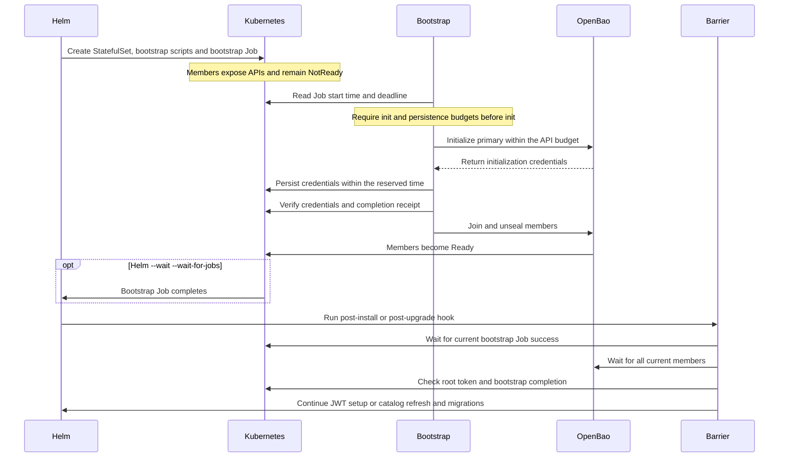

# NVCF OpenBao Helm Chart

This repository contains an opinionated Helm chart for deploying OpenBao in the
NVIDIA Cloud Functions (NVCF) self-hosted environment.

## Overview

The chart is designed to provide:

- An OpenBao server deployment built on top of the upstream
  `openbao/openbao-helm` chart
- A bootstrap Job that initializes and unseals members before readiness
- Post-install JWT configuration and post-install/post-upgrade migrations
- Opinionated defaults for HA, injector enablement, and operational hooks

## Readiness and bootstrap

The server readiness probe accepts active and standby members after unseal.
Sealed and uninitialized members stay NotReady. Client Services must set
`openbao.server.service.publishNotReadyAddresses=false` to exclude them from
routing. The self-managed HA values set this flag; standalone installs must
set it explicitly. Keep the internal headless Service publishing NotReady
addresses so Raft peers can discover one another during bootstrap.

The chart creates a regular bootstrap Job with the StatefulSet. It uses each
member's local API while the member is NotReady, initializes the primary,
saves and verifies credentials, marks bootstrap complete and joins/unseals peers. Bootstrap requires
`openbao.server.podManagementPolicy=Parallel`; `OrderedReady` would prevent
successor Pods from starting before the primary is initialized.

With the default `OnDelete` strategy, Helm 3 `--wait` does not wait for the
StatefulSet's Pods to become Ready. Adding `--wait-for-jobs` waits for the
regular bootstrap Job. Independently of those flags, the post-install hook
waits for the current bootstrap Job to succeed, initialized, unsealed members
and the saved root token before JWT
setup. A wait-only post-upgrade hook runs before catalog refresh and migrations.
These hooks never initialize members. `initializeCluster.schedulingGates`
applies only to the post-install JWT Job. An external controller must release
those gates; bootstrap and the upgrade barrier are ungated.



Bootstrap waits up to `openbao.hooks.initializeCluster.apiTimeoutSeconds`
(default 600 seconds) per API/bootstrap wait phase. Status calls have a
five-second cap. Credential persistence has a separate
`openbao.hooks.initializeCluster.credentialTimeoutSeconds` budget (default
120 seconds) per Secret operation. Standalone scripts accept the equivalent
`OPENBAO_CREDENTIAL_TIMEOUT_SECONDS` setting. Slow credential reads do not use
the status polling cap. It reads the StatefulSet replica count
and selects the `openbao` container by name. A new Job name on each release
revision avoids immutable Job-template errors on upgrade. Existing initialized
members reuse saved credentials. Inconsistent state or missing credentials
fails closed instead of initializing again; restore the matching data and
credentials before retrying. Secret patches include the version read, so a
concurrent restore causes a conflict and a reread instead of an overwrite.
The completion check also rereads the desired replica count before releasing
the next hook.

The bootstrap Job has an overall deadline of three times the API budget plus four
credential budgets and 60 seconds for startup. The default is 2340 seconds.
All Job retries share this deadline. Before init, the script reserves one API
budget, three credential budgets and 60 seconds. It bounds the init request
and caps later persistence at 30 seconds before Pod expiry. A late attempt
fails before initialization if this reserve is unavailable. Hooks check the Job first and allow a
further 60 seconds to observe termination. After Job success, the final API,
member and credential checks get a fresh API budget. Set the Helm or Helmfile
release timeout to cover both waits; use at least one hour with the defaults.

New root-token Secrets atomically save `bootstrap_state=pending` and a digest
of the original unseal key or recovery shares. A retry must match that digest
before marking completion. Completion uses a version check on the root Secret,
then rereads the secondary Secret's UID, version and data. A concurrent change
revokes completion. A separate `bootstrap_verified=true` receipt is saved only
after this reread. Retries, including later release revisions, must finish
verification when the receipt is missing. Hooks require this receipt and wait
for the current bootstrap Job to succeed.

If credential persistence fails, check the root-token and recovery-key Secrets
independently. The script attempts both writes; Kubernetes can reject both.
A root token that was successfully saved remains available for recovery.
Restore or recover a valid root token with the supported recovery procedure
before retrying if its Secret is missing. Retries and hooks reject pending state.
Restore the matching recovery-key Secret only if the original shares were
saved or exported. A root token or KMS access cannot reconstruct lost shares.
For an unused fresh cluster with no application data, an operator can explicitly
choose to remove that cluster's data and bootstrap Secrets and initialize a
replacement. Never apply this procedure to an existing deployment with data.
Preserve its data, saved credentials and seal-provider configuration, and use
the supported recovery procedure or verified backups. Resolve missing shares
with the deployment's recovery owner before retrying. Initialization is never
automatically repeated. Pending Secrets without the original digest require
operator recovery; a retry cannot certify arbitrary recovery shares.

Once `bootstrap_state=complete` and `bootstrap_verified=true`, recovery keys can
be exported and the recovery-key Secret deleted.
Do not delete the completion, digest or verification fields from the root-token
Secret. Resolve pending credentials before rolling back to a chart that does
not check these fields.

### Recovery-key export

Before export, prevent bootstrap retries and all other writers from changing
either Secret. Keep this exclusion through verification and deletion. Compare
the exported shares with the stored digest before deleting the recovery-key
Secret. The completion receipt records an earlier check; it does not lock the
Secret against later changes. Retain the Secret if writer exclusion or digest
verification cannot be completed.

For new installations with the digest field, run this example in Bash from the
repository root. Set `KUBE_CONTEXT` and `OPENBAO_NAMESPACE` to the target cluster
and namespace. Adjust `OPENBAO_SERVER_NAME` if the server fullname differs.
The command writes a private export file and prints only its path on success.

```bash
(
  set -euo pipefail
  : "${KUBE_CONTEXT:?Set the target Kubernetes context}"
  : "${OPENBAO_NAMESPACE:?Set the target OpenBao namespace}"
  server=${OPENBAO_SERVER_NAME:-openbao-server}
  source deploy/helm/openbao/helm/scripts/utils/bootstrap.sh
  expected=$(kubectl --context "$KUBE_CONTEXT" -n "$OPENBAO_NAMESPACE" \
    get secret "$server-root-token" -o json | jq -er '
    select((.data.bootstrap_state | @base64d) == "complete" and
           (.data.bootstrap_verified | @base64d) == "true") |
    .data.bootstrap_credential_digest | @base64d |
    select(test("^[a-f0-9]{64}$"))')
  umask 077
  recovery_file=$(mktemp "${TMPDIR:-/tmp}/openbao-recovery.XXXXXX")
  trap 'rm -f -- "$recovery_file"' EXIT
  trap 'exit 130' INT
  trap 'exit 143' TERM
  kubectl --context "$KUBE_CONTEXT" -n "$OPENBAO_NAMESPACE" \
    get secret "$server-recovery-keys" -o jsonpath='{.data.recovery_keys_b64}' | \
    base64 -d > "$recovery_file"
  actual=$(bootstrap_credential_digest auto "$(cat "$recovery_file")")
  test "$actual" = "$expected"
  printf 'Verified recovery-key export: %s\n' "$recovery_file"
  trap - EXIT INT TERM
)
```

Store and verify the exported file in the approved recovery store. Remove the
private local export after that copy is verified, then delete the recovery-key
Secret while writer exclusion still holds. Failed or interrupted verification
removes its temporary export automatically. Older installations without a stored digest need their existing share
verification procedure. Ask the recovery owner to verify those shares; do not
create a digest from an unverified Secret to bypass this check.

### Existing installations

Existing root-token Secrets without this field retain the legacy credential
checks. Before upgrading a previously failed auto-unseal installation, verify
that its recovery shares were saved or exported; an unsealed server and a root
token alone do not prove this. The chart cannot reconstruct lost recovery shares.

When upgrading with `--reuse-values`, explicitly replace the old readiness
path, which otherwise remains in the reused values:

```bash
helm upgrade openbao-server helm --namespace vault-system \
  --reuse-values \
  --set openbao.server.service.publishNotReadyAddresses=false \
  --set-string 'openbao.server.readinessProbe.path=/v1/sys/health?standbyok=true' \
  --wait --wait-for-jobs --timeout 60m
```

Retain your image, namespace and migration overrides when upgrading. With an
`OnDelete` StatefulSet strategy, the probe change reaches each Pod only after
that Pod is recreated. Roll one member at a time and verify recovery and Raft
quorum before continuing. Rollback also restores only the StatefulSet template.
After rolling back to an older chart, replace Pods one at a time to restore
that chart's probe on running members. Verify recovery and quorum before
replacing the next Pod.

### Upgrading an existing OrderedReady StatefulSet

`podManagementPolicy` cannot be changed in place. Keep the existing Pods,
PVCs and bootstrap Secrets while replacing only the StatefulSet controller.
Run this procedure from `deploy/helm/openbao` with the candidate dependencies
built. Use the original release, namespace and StatefulSet names. Do not combine
this procedure with image, storage, selector, Service name or replica changes.
Verify all members are initialized, unsealed and have Raft quorum first.

Save the current StatefulSet manifest and the Pod/PVC UIDs for comparison.
Render the candidate with the same overrides and check that selectors, Service
name and volume-claim templates still match. Keep existing image, migration
and JWT lifecycle settings through `--reuse-values` and your original overrides.

```bash
namespace=vault-system
release=openbao-server
statefulset=openbao-server
kubectl -n "$namespace" get statefulset "$statefulset" -o yaml > orderedready-statefulset.yaml
kubectl -n "$namespace" get pods -o json > orderedready-pods.json
kubectl -n "$namespace" get pvc -o json > orderedready-pvcs.json

kubectl -n "$namespace" patch statefulset "$statefulset" --type=merge \
  -p '{"spec":{"persistentVolumeClaimRetentionPolicy":{"whenDeleted":"Retain","whenScaled":"Retain"}}}'
```

Wait for any PVC owner references to the old StatefulSet or its Pods to be
removed by the retention-policy reconciliation. Then orphan its dependents.
Do not delete Pods, PVCs or Secrets.

```bash
kubectl -n "$namespace" delete statefulset "$statefulset" --cascade=orphan --wait=true
helm upgrade "$release" helm --namespace "$namespace" --reuse-values \
  --set openbao.server.podManagementPolicy=Parallel \
  --set openbao.server.updateStrategyType=OnDelete \
  --set openbao.server.persistentVolumeClaimRetentionPolicy.whenDeleted=Retain \
  --set openbao.server.persistentVolumeClaimRetentionPolicy.whenScaled=Retain \
  --set openbao.server.service.publishNotReadyAddresses=false \
  --set-string 'openbao.server.readinessProbe.path=/v1/sys/health?standbyok=true' \
  --wait --wait-for-jobs --timeout 60m
```

Confirm the replacement StatefulSet uses `Parallel` and has adopted the same
Pods. Their controller owner reference must use the replacement StatefulSet
UID. Compare Pod and PVC UIDs with the saved snapshots, verify quorum and check
that saved credentials and cluster identity are unchanged. `OnDelete` keeps
existing Pods running during adoption. Replace them one at a time later to
apply the strict probe, verifying recovery and quorum between replacements.
Keep PVC retention set to `Retain` during this procedure. Restore a different
retention or rollout policy only after adoption and recovery checks pass.

### Resuming a standalone installation

For a failed standalone installation whose data and saved bootstrap Secrets
are intact, resume against the existing resources from this directory:

```bash
bash deploy.sh vault-system openbao-server helm
```

Use the original namespace and StatefulSet name. This existing-resources mode
requires `kubectl`, `jq`, `jwker` and either `sha256sum` or `shasum`. It skips
Helm installation and reuses saved
credentials before joining/unsealing remaining members and configuring JWT.
The default `script` mode remains for fresh installations. Missing credentials
or mismatched data require recovery before retrying; do not delete resources
as a routine retry step.

## JWT plugin lifecycle

The bridge server image supplies declarative plugin registration at
`/openbao/plugin-config`; its entrypoint loads that directory on server startup.
Set `openbao.jwtPluginLifecycle.mode` for the deployment stage:

- `legacy` (default): retains the refresh hook for published pre-bridge images.
  Preflight rejects versioned images before changing the release.
- `bridge`: checks existing mount compatibility without rewriting the catalog.
  Defers migrations. Keep hooks enabled and rotate every member before enabling
  versioned mount creation. Upgrades only.
- `versioned`: checks image compatibility and pins new signing mounts to the
  target version from the server image. Use for fresh bridge installations
  and after an existing deployment completes its bridge migration.

The lifecycle driver can check and tune mounts independently of Helm hooks.
The migration Job rechecks catalog readiness after rollout because the active
member can change after preflight. Its init container also supplies the server
image's version manifest to migrations.

Publish and qualify the matching bridge server and migrations images before
advancing chart or stack image pins. Existing deployments need the staged
[JWT plugin upgrade procedure](../../../docs/self-managed/runbooks/openbao-jwt-plugin-upgrade.md),
including the explicit old version and a later cleanup release.

## Prerequisites

- Kubernetes cluster compatible with the bundled upstream OpenBao chart
- Helm 3
- `kubectl` configured for the target cluster
- Access to the required container images

## Images

This repository is published as chart source only.

This chart depends on NVIDIA-managed container images for the OpenBao server
extensions, migration jobs, and related operational tooling.

The default chart values do not set the required image registries and
repositories for those components. They must be supplied through an additional
values file at install time, and access to those images must be arranged
separately.

Example:

```yaml
openbao:
  migrations:
    image:
      registry: nvcr.io
      repository: <your-org>/nvcf-openbao-migrations
  server:
    image:
      registry: nvcr.io
      repository: <your-org>/nvcf-openbao
  injector:
    image:
      registry: nvcr.io
      repository: <your-org>/oss-vault-k8s
    agentImage:
      registry: nvcr.io
      repository: <your-org>/nvcf-openbao
```

The injector Deployment uses `openbao.injector.image` (`oss-vault-k8s`). The
Vault Agent sidecars it creates use `openbao.injector.agentImage`. The
self-managed stack selects `nvcf-openbao` for both the agent and server; the
auto-unseal sidecar also uses the server image. The chart checks that their
tags match. The shipped stack selects no third-party Vault Agent image.
Standalone installs supply the registries and repositories shown above.
Operators who select a separate agent image own its toolchain and CA bundle
verification.

## Installation

This chart is intended to be installed by invoking Helm directly from source.

1. Build dependencies:

```bash
helm dependency build helm
```

1. Install the chart:

```bash
helm install openbao-server helm \
  --namespace vault-system \
  --create-namespace \
  --values helm/values.yaml \
  --values path/to/values.yaml \
  --set openbao.server.service.publishNotReadyAddresses=false \
  --wait \
  --wait-for-jobs \
  --timeout 60m
```

## Configuration

Chart configuration lives in [helm/values.yaml](./helm/values.yaml). Additional
values files can be layered on top during installation.

Key configurable areas include:

- OpenBao server image settings and HA configuration
- Migration job image settings and migration environment variables
- Injector image settings
- Image pull secrets
- OIDC issuer discovery for migration-time JWT auth configuration

Important note on Helm list merging:

When overriding list values such as `extraContainers`, Helm replaces the
original list instead of merging it. Override the full list item to preserve
required fields from the base values file.

### Migration kubectl client

`openbao.migrations.kubectlMinor` controls both the initialization and migration
Jobs. Leave it empty to use the image default, or set `"1.36"` for Kubernetes
1.35 servers. The migrations 0.23.1 image provides kubectl 1.37.2 by default
and the patched 1.36.6 client through `NVCF_KUBECTL_MINOR="1.36"`. An explicit
`"1.37"` is also supported; other selections fail rendering.

Use an image that implements `NVCF_KUBECTL_MINOR` when setting this value.
Configure the selector here rather than also setting it in
`openbao.migrations.env`; specifying both fails rendering. Existing env-only
configuration still applies to the migration Job when `kubectlMinor` is empty.

## Uninstallation

```bash
helm uninstall openbao-server --namespace vault-system
```

## License

This project is licensed under the
[Apache License, Version 2.0](https://www.apache.org/licenses/LICENSE-2.0).
