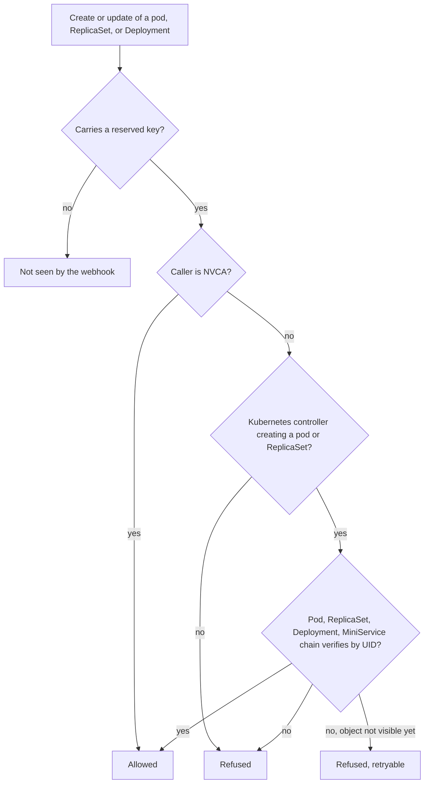

# Utils Provenance Protection

The NVCF worker (the utils pod) of a Helm function instance runs with extra
trust: NVCA mutates it differently from the function's own pods, and the
platform treats its metadata as infrastructure metadata. Utils provenance
protection makes sure that only NVCA can create or change that metadata. A
Helm chart, or an operator running inside the chart, cannot make one of its
own pods look like a utils pod, and cannot change the utils Deployment.

This page covers how the protection works, how to roll it out, what it
changes for existing clusters, and how to check that it is active.

## How it works

NVCA reserves a small set of keys for infrastructure objects in instance
namespaces:

- the label `nvca.nvcf.nvidia.io/pod-role: utils`
- the annotation `nvca.nvcf.nvidia.io/nvca-infra-object`
- a MiniService owner reference

A validating webhook in the NVCA webhook server checks every create or update
of a pod, Deployment, ReplicaSet, or scale request that carries one of these
keys. The webhook never sees objects that carry none of them.

- NVCA may write the keys.
- The Kubernetes ReplicaSet and Deployment controllers may create the pods and
  ReplicaSets of a utils Deployment that NVCA created. NVCA verifies the owner
  chain from the pod to the MiniService by UID before it accepts such a pod.
- Every other identity is refused, including the service accounts a chart runs
  as.



Scale subresources and ephemeral containers on utils objects are protected by
Kubernetes RBAC: the service accounts NVCA creates for instances are not
granted them, and Kubernetes does not let those accounts grant them to
others. The webhook adds a second check.

## Modes

The mode is set with the Helm value `agent.utilsProvenance.mode`.

| Mode | Behavior |
| --- | --- |
| `audit` (default) | The webhook logs and counts what it would refuse, and allows every request. Nothing existing changes. |
| `enforce` | The webhook refuses what the rules refuse. NVCA also removes reserved keys from chart objects and drops unsafe allowed extra types (see Compatibility). |

The webhook and NVCA read the mode at start, so changing it restarts them.
With defaults, the operator, NVCA pod, and webhook container are unchanged.

If your cluster reports different usernames for the Kubernetes controllers,
set `agent.utilsProvenance.replicaSetControllerUser` and
`agent.utilsProvenance.deploymentControllerUser`. The defaults are
`system:serviceaccount:kube-system:replicaset-controller` and
`system:serviceaccount:kube-system:deployment-controller`, which are the names
observed on k3s and kind.

Requirement: Kubernetes 1.28 or later. NVCA resolves its own username with a
SelfSubjectReview when the webhook server starts. If that fails, the webhook is
left unregistered and the other webhooks keep running.

## Compatibility

Enforcement changes behavior in two places.

Reserved keys on chart objects. In enforce mode NVCA removes the reserved
label, the infra-object annotation, and MiniService owner references from
objects a chart creates, and logs each removal. A chart that set these keys
loses them. In audit mode NVCA only logs what it would remove.

Allowed extra types. The cluster configuration field
`validationPolicy.allowedExtraKubernetesTypes` adds resource types to the Role
that instance workloads receive. In enforce mode NVCA drops entries that would
grant control over utils pods and logs a warning for each:

- the `scale` subresource of any resource, for example `deployments/scale`
- the `ephemeralcontainers` subresource of pods
- wildcards in the resource, or the wildcard group

In audit mode these entries are kept and a warning says they will be dropped
when enforcement is enabled.

What this can break:

- A chart that scales its own Deployment through the scale subresource from
  inside the instance namespace, for example its own autoscaler, can no longer
  do so. Use a HorizontalPodAutoscaler (scaling is done by the Kubernetes
  controller manager, not by the chart's service account), or set the replica
  count in the chart values.
- Debugging with ephemeral containers from a chart service account stops
  working. Administrators using their own credentials are not affected.

Before enabling enforcement:

1. Search the NVCA logs from a period in audit mode for the warnings above, and
   for `Chart object carries reserved utils metadata`.
2. Review `allowedExtraKubernetesTypes` in the cluster configuration and remove
   or replace the entries listed above.
3. Confirm that no chart you run depends on them.

## Rolling out enforcement

Order matters. Enforcement must be active before you look at existing objects,
or forged objects can still appear while you scan.

1. Run in audit mode for at least one release. Review the counter
   `nvca_webhook_utils_provenance_decisions_total` for `audit_would_deny`
   decisions. Every reason must be explained.
2. Set `agent.utilsProvenance.mode` to `enforce` and upgrade.
3. Confirm that enforcement is active. Admission changes take effect after a
   delay, so do not assume it. NVCA runs a readiness check in enforce mode: it
   sends a forged pod, as a dry run, as a low-privilege account in a canary
   namespace, and counts only a refusal by the provenance webhook for the
   expected reason. An RBAC denial, another webhook's refusal, a timeout, or an
   unavailable webhook does not count. Enforcement is verified after three
   refusals in a row, and the result expires if the check stops. The gauge
   `nvca_utils_provenance_enforcement_verified` is 1 only while it holds.
4. The same check reviews the effective permissions of every service account in
   instance namespaces, including every RoleBinding and ClusterRoleBinding.
   The review also covers rules restricted to specific object names, which
   apply only to a request that names the object. It asks about the utils
   Deployment, ReplicaSets, and pods by name, using the objects that exist and
   the expected name `utils`. The gauge `nvca_utils_provenance_rbac_verified`
   is 1 only while no account can update or patch a protected scale or
   ephemeral container subresource.
5. Clear the inventory. The canary proves current admission behavior. It does
   not prove that objects created earlier are genuine. NVCA records when
   enforcement was first verified and every period in which it was not
   (including a period in which the check was silent), and scans for objects
   that carry reserved keys and were created, or had a reserved key written, in those periods. The last write is read from the object's managed fields. An object with a reserved key that no managed field accounts for is treated as suspect. Timestamps are not a complete write history, so an object that was alive during any unverified period is trusted only if its content matches what NVCA recorded when it created the utils Deployment: the pod spec digest of the Deployment and ReplicaSet templates, a digest of the rest of the Deployment spec (replica count, selector and rolling strategy), the replica count that ReplicaSets may not exceed, singly or together, and the container names, images, commands and arguments of the pods. NVCA stores those digests in the MiniService status, which instance service accounts cannot write. An HA instance without recorded digests, or with a changed template, keeps the inventory open until the instance is recreated. An instance created shortly before an NVCA restart can also be reported, even when its content matches, because NVCA cannot prove enforcement for the last interval before the restart. The recorded period does not change later, so a new verified period does not clear such an instance: under the current implementation it stays reported until it is remediated, which today means recreating it. Recreating an instance interrupts it, so investigate the report first and do not treat recreation as routine cleanup. A clean scan
   clears the inventory. Any loss of verification opens a new period and
   closes the inventory again until the next clean scan. The gauge
   `nvca_utils_provenance_inventory_cleared` is 1 only while a clean scan covers
   the current state, and `nvca_utils_provenance_inventory_suspects` is the
   number of suspect objects at the last scan. The record is kept in the
   ConfigMap `nvca-utils-provenance-rollout` in the NVCA namespace.

   You can also list the objects yourself:

   ```sh
   kubectl get ns -l nvca.nvcf.nvidia.io/workload-instance-type=miniservice -o name
   kubectl -n NAMESPACE get pods,replicasets,deployments,statefulsets,jobs,cronjobs -o json \
     | jq -r '.items[] | select(
         (.metadata.labels // {} | has("nvca.nvcf.nvidia.io/pod-role"))
         or (.metadata.annotations // {} | has("nvca.nvcf.nvidia.io/nvca-infra-object"))
         or ((.metadata.ownerReferences // []) | map(.kind) | index("MiniService"))
         or (.spec.template.metadata.labels // {} | has("nvca.nvcf.nvidia.io/pod-role")))
         | "\(.kind)/\(.metadata.name)"'
   ```

   Expected: the `utils` pod and the `nvcf-smb-server` pod in each instance
   namespace, which carry the infra-object annotation. Anything else needs
   review.

## When readiness is lost

Replicas and label-based recognition of utils pods only turn on while the
rollout gate is open: enforcement verified, the instance RBAC verified, and the
inventory cleared. If the gate closes later:

- An instance that already runs several utils pods keeps them. NVCA does not
  shrink it and does not treat its utils pods as chart workloads.
- Changes that rely on the protection are paused: more replicas, utils template
  changes, and new utils objects. Instance deletion and cleanup are never
  paused.
- The MiniService gets the condition `UtilsProvenanceDegraded` with the reason.
  It clears when the gate reopens.
- An instance that has no such record uses one utils pod, and a labeled pod in
  it is not recognized as a utils pod.

The gate reopens on its own when readiness returns and a clean inventory scan
covers the period in which it was lost.

## Monitoring

| Metric | Meaning |
| --- | --- |
| `nvca_webhook_utils_provenance_decisions_total` | Decisions by kind, decision (`allow`, `deny_hard`, `deny_retry`, `audit_would_deny`), and reason. |
| `nvca_utils_provenance_enforcement_verified` | 1 while the canary proves enforcement. |
| `nvca_utils_provenance_rbac_verified` | 1 while no instance account holds a protected right. |
| `nvca_utils_provenance_readiness_checks_total` | Readiness checks by check (`canary`, `rbac`) and outcome. |
| `nvca_utils_provenance_inventory_cleared` | 1 while a clean inventory scan covers the current state. |
| `nvca_utils_provenance_inventory_suspects` | Objects with reserved keys created or written while enforcement was not verified, at the last scan. |

Refusal log lines carry the kind, name, namespace, calling user, reason, and
mode. Object contents are never logged.

## Troubleshooting

- `enforcement_verified` stays 0: look at `readiness_checks_total` for the
  outcome. `accepted` means the webhook did not refuse the canary, so
  enforcement is not active. `other_denial` means something else refused it,
  for example RBAC or another webhook. `inconclusive` means the webhook or API
  server timed out or was unavailable.
- `rbac_verified` stays 0: an account holds a protected right through a
  RoleBinding or ClusterRoleBinding. The NVCA log lists the account and the
  right. Remove the binding.
- A utils pod is refused with a retryable error: the ReplicaSet was not yet
  visible to the webhook. The webhook retries briefly, and the controller
  retries after that. Kubernetes controllers back off after a refusal, so a
  retryable refusal can delay a pod by a minute or more. Persistent retryable
  refusals point to API server latency.
