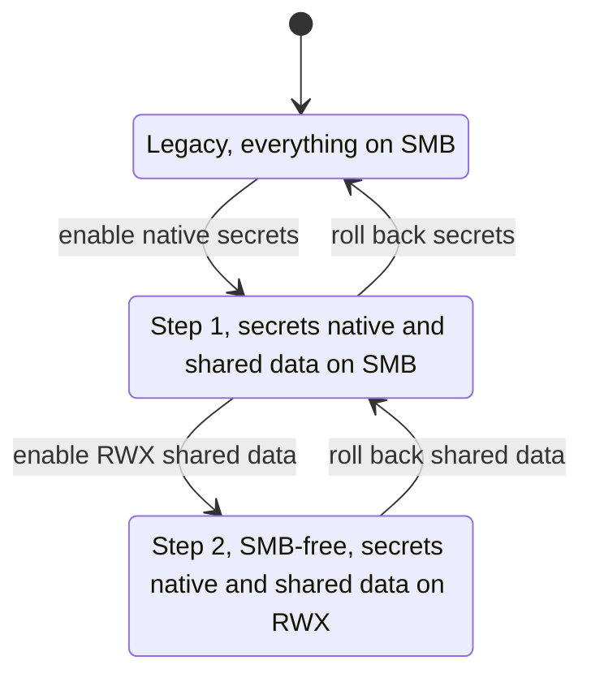
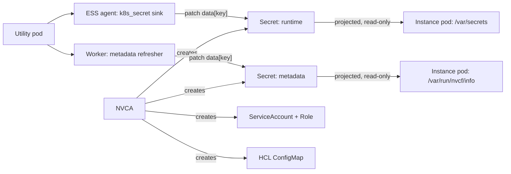
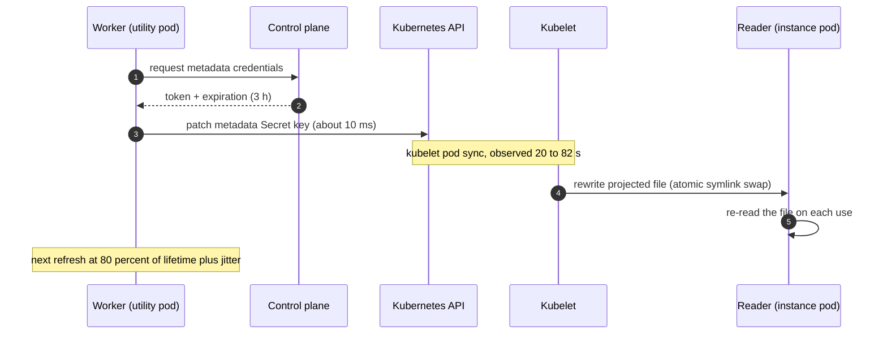

# SDD: Shared Storage V2, Kubernetes-native secret delivery

Status: draft for review. Tracks the work to replace SMB shared storage in self-managed NVCF with Kubernetes-native backends.

## Goal

Deliver per-function sensitive data and metadata credentials to workloads through
Kubernetes Secrets instead of the in-cluster SMB server and SMB CSI volumes, while
keeping the existing file paths and keeping SMB as the default until deployments
migrate.

## Scope

In scope:

- `/var/secrets` (runtime secrets) and `/var/run/nvcf/info` (metadata credentials).
- The configuration that selects the secret backend, independently of the shared-data
  backend.

Out of scope for this document:

- `/var/task` and model-cache data. They stay on SMB until the RWX backend ships.
- Removing the SMB CSI checks and the samba image default.

## The move at a glance

For the secrets path, the SMB server and the SMB CSI volumes are replaced by Kubernetes Secrets
that the kubelet projects into the instance pod. The files appear at the same paths, so
workloads do not change. `/var/task` and model-cache data stay on SMB until the RWX backend ships.

Red boxes go away in native mode, green boxes are new, and grey boxes do not change.

```mermaid
flowchart TB
  subgraph TODAY["TODAY: SMB (the default)"]
    direction LR
    A1["Utility pod writes files"] --> A2["SMB CSI volume, read-write"]
    A2 --> A3["SMB server pod and its data PVC"]
    A3 --> A4["SMB CSI volume, read-only"]
    A4 --> A5["Instance pod reads /var/secrets and /var/run/nvcf/info"]
  end
  subgraph NATIVE["NATIVE: secretBackend = k8s-native"]
    direction LR
    B1["Utility pod patches one key through the Kubernetes API"] --> B2["Kubernetes Secret"]
    B2 --> B3["Kubelet projects the Secret, read-only"]
    B3 --> B4["Instance pod reads the same two paths"]
  end
  classDef removed fill:#fde2e2,stroke:#c0392b,color:#000
  classDef added fill:#e2f5e2,stroke:#2e8b57,color:#000
  classDef same fill:#ececec,stroke:#666,color:#000
  class A2,A3,A4 removed
  class B1,B2,B3 added
  class A1,A5,B4 same
```

| | Today (SMB) | Native secrets |
|---|---|---|
| Where the data lives | Files on an SMB share served by a pod | Keys in Kubernetes Secrets |
| Extra pods and volumes for this data | SMB server pod, data PVC, SMB CSI volumes | None |
| Needs the SMB CSI driver | Yes | No, for this path |
| File paths seen by the workload | `/var/secrets`, `/var/run/nvcf/info` | The same |
| How an update reaches the workload | Direct write to the shared mount (not measured) | After the kubelet syncs, observed at 20 to 82 seconds |
| Still on SMB in this milestone | `/var/task`, model cache | `/var/task`, model cache |

The two backends are selected independently, so operators move one step at a time and can
roll back one step at a time:

## What runs today

NVCA creates SMB-backed volumes for each Helm workload:

| Data | PVCs | Mount path |
|---|---|---|
| Runtime secrets | `nvcf-secrets-data-rw`, `nvcf-secrets-data-ro` | `/var/secrets` |
| Metadata credentials (KNS) | `nvcf-kns-data-rw`, `nvcf-kns-data-ro` | `/var/run/nvcf/info` |
| Task data | `nvcf-task-data-rw` | `/var/task` |

The utility pod mounts the read-write claims and writes into them. The ESS agent
(a fork of HashiCorp consul-template, `src/compute-plane-services/ess-agent`) renders
templates to a filesystem `destination`. The worker writes the metadata token to
`/var/run/nvcf/info/self` using a temporary file and a rename
(`src/libraries/go/worker/nvcf/metadata.go`). Instance pods mount the read-only
claims. The mounts are applied through webhook annotations, and the SMB server image
comes from `agent.sharedStorage.server.image` in the NVCA configuration.

## Design

### Backend selection

`secretBackend` and `sharedDataBackend` are independent settings:

| `secretBackend` | Behavior |
|---|---|
| unset or `smb` | Existing behavior. This is the default. |
| `k8s-native` | Secrets, ServiceAccount, Role and ConfigMap as described below. |

When the new fields are omitted, behavior is unchanged. Invalid values, incompatible
combinations and an ambiguous default RWX class are rejected at configuration time.
The configuration reaches the agent through `NVCA_SHARED_STORAGE_CONFIG_JSON_BASE64`
and the operator chart values.

### Secret objects

NVCA creates, per function instance, and attaches them to the `StorageRequest` ownership
lifecycle:

- a runtime Secret with two keys, `secrets.json` and `accounts-secrets.json`, one per ESS
  template that writes under `/var/secrets` today. The BYOO collector reads
  `/var/secrets/accounts-secrets.json` by default, so native mode has to deliver it;
- a metadata Secret, holding the metadata credential under the key `self`;
- a ServiceAccount for the utility workload and a Role that grants only `get` and
  `patch` on those two Secrets through `resourceNames`;
- a ConfigMap with the per-function ESS HCL that names the Secret references;
- an optional NetworkPolicy.

Names are proposed as `<storagerequest>-runtime` and `<storagerequest>-metadata`. This is a
decision to confirm.

Size budgets: 768 KiB decoded per key and 900 KiB decoded for all keys of one Secret, so the
two runtime keys share the 900 KiB.
The Kubernetes API accepts at most 1,048,576 bytes of data per Secret, so the budgets
leave about 124 KiB of headroom. Writers reject a value over budget before calling the API.

### Writers

- **ESS agent.** A template sink, `k8s_secret { name namespace key }`, as an
  alternative to `destination`. Setting both is rejected. It patches only the owned
  `data[key]` with the in-cluster client, treats an unchanged value as a no-op, and
  returns distinct errors for NotFound, Forbidden and retryable API failures.
- **Worker.** When `NVCF_METADATA_CREDENTIALS_SECRET_NAME` and
  `NVCF_METADATA_CREDENTIALS_SECRET_KEY` are set, the metadata refresher patches that Secret
  key. Without them it keeps writing `/var/run/nvcf/info/self`. `ESS_HCL_SOURCE`, when set,
  makes the worker copy that file verbatim into the ESS agent shared configuration
  directory.

### Readers and mounts

- Instance workloads receive the Secrets as **projected volumes, read-only, mounted as whole
  directories**. The files appear at `/var/secrets/secrets.json`,
  `/var/secrets/accounts-secrets.json` and `/var/run/nvcf/info/self`, so existing paths stay
  compatible.
- `subPath` mounts are not allowed. A `subPath` file never receives updates (measured below).
- NVCA applies a typed mount plan, built from `StorageRequest.Status.SharedStorage`, to Pods
  and pod templates in Deployments, ReplicaSets, StatefulSets, Jobs and CronJobs, including
  every container and init container.
- The utility workload receives its HCL ConfigMap, `ESS_HCL_SOURCE` and the writer
  ServiceAccount. It does not mount the read-only sensitive-data Secrets.

## Update propagation

A write reaches the workload only after the kubelet rewrites the projected volume. The
kubelet on a default cluster has `syncFrequency: 1m` and uses the `Watch` change-detection
strategy, so the cache is current almost immediately and the file is rewritten on the pod
sync.

The sequence below shows a metadata credential refresh and where the delay sits:

### Measurements

Two experiments on a local k3d compute cluster, 23 updates in total. The API patch itself took
7 to 9 ms.

| Experiment | Updates | Min | Median | Max |
|---|---|---|---|---|
| Patch immediately after the previous update was observed (worst phase), small Secret | 8 | 49 s | 70 s | 77 s |
| Same, Secret near the size budget (about 690 KB) | 3 | 68 s | 77 s | 82 s |
| Writer and reader sidecars in one pod, varied phase | 12 | 19.7 s | 44.8 s | 69.0 s |

These are observations from one local cluster, not an upper bound. The 120 second budget is a
design allowance, not a measured maximum.

Secret size did not change the delay. File replacement is atomic: the kubelet swaps a
`..data` symlink, so a reader never sees a partial file.

### Budget and rules

1. The design budget for Secret-to-file propagation is **120 seconds**.
2. **Consumers must re-read the file on each use.** A process must not cache the content
   for its lifetime.
3. **Initial population.** The Secret key must exist before the workload starts. NVCA
   creates the Secret with the first value, or the workload waits for it. A missing key
   would otherwise leave the file absent until the first sync.
4. **Metadata credentials.** The worker refreshes at 80% of the reported lifetime plus up to
   60 seconds of jitter, retrying every minute after a failure
   (`src/libraries/go/worker/token/token.go`). The new value reaches the workload about
   0.8 x lifetime + jitter + propagation delay after issue, plus 60 seconds for every failed
   refresh attempt before it succeeds. With N failed attempts this is safe when
   `0.2 x lifetime - 60 s (jitter) - 120 s (propagation budget) - 60 s x N` is positive. The
   server reports a lifetime of 3 hours, which allows about 33 failed attempts (about 33
   minutes of failures) before the old token can expire. The token's own `exp` is set by the
   notary service and has not been verified: see Open items. Validation must check the
   real margin before native mode is enabled.

## Security

- The writer Role grants `get` and `patch` on the two named Secrets only. In the experiment,
  patching or reading a different Secret returned 403.
- Sensitive data is stored in etcd. Encryption at rest is a cluster setting. Non-local
  clusters need evidence that it is enabled. A local functional test does not
  validate this control.
- Values are not logged. Secrets are owned by the `StorageRequest` and removed with it.

## Coexistence and migration

- SMB stays the default. Settings that omit the new fields behave as before.
- Existing `StorageRequest`s keep their pinned backend. A change to the settings affects
  new requests.
- `secretBackend` and `sharedDataBackend` are independent, so `k8s-native` secrets can run
  with SMB-backed task data and model cache.
- Rollback returns `secretBackend` to `smb` for new requests. An existing `k8s-native` request
  keeps its backend, so to return a function to SMB, redeploy it: the new deployment creates a
  new `StorageRequest` under the restored setting, the utility pod writes the files to the SMB
  volumes as it does today, and the old request and its Secrets are removed with it. Migrating
  a live request in place is not designed here. The rollout guide describes the steps for both
  SMB backends.
- Mixed versions need a defined behavior, for example a new ESS agent with an older NVCA. The
  ESS agent keeps supporting `destination`, so an older NVCA is unaffected.

## Known limitation and workaround

Updates were observed to take 20 to 82 seconds to appear. That is an observed range, not a
maximum. For deployments that need faster
propagation, the cluster operator can lower the kubelet `syncFrequency`. That setting is
node-level, adds sync load, and was not tested for this document, so treat it as optional
tuning and verify it on your own cluster.

## Validation

- `nvcf_shared_storage_cold_start_seconds` with the labels `secret_backend`,
  `shared_data_backend` and `smb_server_expected`.
- Tests for projected-file latency, Secret updates, metadata updates and RBAC.
- A fully SMB-free configuration also needs the RWX backend and the SMB CSI changes.

## Open items

- Verify the real `exp` of the signed metadata token on a running function worker.
- Audit which components read `/var/run/nvcf/info/self`, `/var/secrets/secrets.json` and
  `/var/secrets/accounts-secrets.json` (including the BYOO collector), and confirm that none
  cache the content.
- Confirm the Secret naming scheme.
- Decide how a workload waits for initial population.
- Collect encryption-at-rest evidence for a non-local cluster.
- Define mixed-version behavior across ESS agent, worker and NVCA.
- Confirm against NVCA's reconcile behavior that redeploying a function is enough to return it
  to SMB, and write the rollout guide.

## Source references

- `src/compute-plane-services/nvca/pkg/storage/sharedstorage.go`, `types.go`
- `src/compute-plane-services/nvca/internal/miniservice/reconcile_storagerequests.go`
- `src/compute-plane-services/ess-agent`
- `src/libraries/go/worker/nvcf/metadata.go`, `src/libraries/go/worker/token/token.go`
- `src/control-plane-services/cloud-functions/nvcf-core/src/main/java/com/nvidia/nvcf/grpc/GrpcWorkerService.java`
