# OpenBao JWT Plugin Upgrade

JWT signing mounts store plugin selection in OpenBao storage. Changing a
Kubernetes image does not change that selection. This procedure introduces
versioned entries without rewriting the existing unversioned catalog digest.
Use a published, qualified bridge server image and its matching chart and
migrations image. Upgrade deployments on the `2.6.3-nv-1.3.6` image to the
published `2.6.3-nv-1.3.7` patch first. Do not substitute a pre-bridge image
during rollback.

Before resuming normal self-managed stack applies, update the stack's
`openbao-server` chart pin to a published chart with the JWT lifecycle modes
and align its image pins with the qualified bridge release. An older pinned
chart cannot preserve the lifecycle mode from the stack environment.

The bridge packages the exact plugin from the digest-pinned public
`2.6.3-nv-1.3.7` image as both the original command and the explicit old
version. It builds the target from repository source. Catalog identities are
recorded in `/openbao/jwt-plugin-versions.env`, independently of the server
version. If your stored unversioned digest differs, stop. Your bridge must
retain that deployment's exact binary instead. A source rebuild is insufficient.

## Preflight

Take a Raft snapshot and secure the unseal material. Require a healthy,
unsealed three-member cluster with one active member. Record the cluster ID,
images, current catalog entries, mount inventory, and a successful signed JWT
and its public verification key. Use the status and standby rotation checks in
the [patch upgrade procedure](openbao-patch-upgrade.md).

All members must use the same CPU architecture. The image generates SHA-256
values from its own binaries, so amd64 and arm64 images need no chart checksum
overrides. A catalog version has one cluster-wide digest; mixed-architecture
OpenBao clusters are not supported by this lifecycle. Do not move a member to
another architecture during the rollback window.

Stop concurrent mount creation, tuning, and other plugin upgrade operations for
the duration of each state transition and cleanup. The driver validates the
complete inventory before tuning, but multiple tune operations are not atomic.
Rerun the same command after fixing a failure to resume.

Do not manually re-register versions declared by the image to repair catalog
drift. Manual registration can replace a declarative entry with a
non-declarative one and block active startup, even when its SHA matches.
Catalog drift requires a separately qualified recovery procedure.

Commands below use Bash, `kubectl`, `jq`, the default namespace, and the
chart-managed root-token Secret. Use an authorized operator credential if your
installation manages tokens differently. Do not enable shell tracing.

```bash
kubectl config current-context
BAO_POD=<current-active-pod>
bao_admin() {
  set -o pipefail
  kubectl -n vault-system get secret openbao-server-root-token -o json |
    jq -er '.data.root_token | @base64d' |
    kubectl -n vault-system exec -i "$BAO_POD" -c openbao -- sh -ec '
      IFS= read -r BAO_TOKEN
      test -n "$BAO_TOKEN"
      export BAO_TOKEN
      export BAO_ADDR=http://127.0.0.1:8200
      exec "$@"
    ' sh "$@"
}
bao_admin bao secrets list -detailed
bao_admin bao plugin info secret vault-plugin-secrets-jwt
```

Confirm the unversioned catalog SHA equals the bridge's original binary SHA
for every server architecture. Compare before replacing any pod; otherwise
an incompatible bridge can make existing mounts unusable on restart.

```bash
BRIDGE_IMAGE=<qualified-bridge-image-reference>
docker run --rm --entrypoint sha256sum "$BRIDGE_IMAGE" \
  /openbao/plugins/vault-plugin-secrets-jwt
```

## Deploy the Bridge

Prepare release values with the qualified bridge server and injected-agent
image tags and matching migrations image. Set the lifecycle mode explicitly:

```yaml
openbao:
  jwtPluginLifecycle:
    mode: bridge
```

The default `legacy` mode supports published pre-bridge images and retains
the catalog refresh hook. Its preflight rejects bridge and target-only images
before the release changes. `bridge` disables the refresh hook and migrations
while checking existing mount compatibility. Keep this setting in the Helm
values and stack environment used for subsequent applies.

The bridge image entrypoint adds `-config=/openbao/plugin-config` to server
startup. Custom commands that bypass that entrypoint must supply the argument.
The image config enables `plugin_auto_register` and declares old and target
versions with their binary hashes.

Update the existing Helm release with hooks enabled. The bridge preflight
compares the candidate's legacy bytes against existing mount and catalog state
before any server template changes:

```bash
BRIDGE_CHART=<qualified-bridge-chart-reference>
RELEASE_VALUES=<existing-release-values-with-bridge-images>
helm upgrade openbao-server "$BRIDGE_CHART" -n vault-system \
  -f "$RELEASE_VALUES" --set openbao.jwtPluginLifecycle.mode=bridge
```

Bridge mode defers migrations until all servers have the target binary and
declarative registration. Do not use `--no-hooks`; that skips the compatibility
check. Bridge mode must not be used for a fresh install.
Do not run the normal stack apply yet. With `OnDelete`, rotate standbys one at
a time, verify recovery, transfer leadership to an upgraded standby, and then
rotate the former active. Follow the patch procedure for those commands and
health checks. Reassign `BAO_POD` after leadership changes. Require every
member's image digest to equal the qualified bridge digest.

Existing unversioned mounts must still issue JWTs after this rotation. Check
each member's versioned binaries and config, then run:

```bash
bao_admin jwt-plugin-lifecycle preflight
bao_admin jwt-plugin-lifecycle status
```

The driver also runs outside Kubernetes or Helm using an authenticated `bao`:
set `JWT_VERSIONS_FILE` to the image's version manifest and `JWT_PLUGIN_DIR` to
its extracted plugin directory. It does not register plugins or restart servers.

## Defer Existing Mount Migration

Use this option only when the selected release's upgrade guide supports it.
The [NVCF 1.0.4 procedure](../../overview/release-notes/1.0.2-to-1.0.4-upgrade.md)
installs the bridge on every server and verifies existing mount identities,
versions, hashes and consumers without tuning or reloading plugins.

After those checks, [enable migrations](#enable-migrations) in `versioned`
mode. Existing mounts retain their selection; new mounts use the target
plugin. Keep both binaries and the original catalog entries. Existing mounts
do not receive the target plugin's fixes until a separate maintenance window
completes the migration below. Do not leave the final stack in `bridge` mode;
that suppresses migrations.

Changing existing mount selections requires the separate maintenance
procedure below. Installing both binaries alone does not complete migration.

## Pin, Rotate, Then Upgrade

When returning from the deferred path, repeat preflight and start here.
Retain `versioned` mode and the bridge images; do not repeat the bridge-mode
apply or remove either binary.

After each tune below, rotate all members to load the configured plugin
version. A local reload and a status check on the active member do not prove
that every member has switched. OpenBao 2.6 global reload is not a substitute
for this rotation.

For each rotation, follow the standby replacement and leadership transfer
checks in the patch upgrade procedure. Replace one standby at a time and wait
for all members to recover before continuing. Transfer leadership to a
recovered member, then replace the former active as a standby. Never replace
multiple members at once. Reassign `BAO_POD` to the current active after each
transfer.

Before and after a normal failover, run the requested `status` or `verify`
check on the actual active member. Issue JWTs, verify their signatures with
retained public keys, and check existing/new consumers and agent renewal.
Confirm the member's local `sys/leader` reports `is_self: true`; a forwarded
standby response does not identify the serving member.

Use `bao operator step-down` on the verified active member and wait for a
different healthy member to become active. Keep the original cluster ID and
voter IDs/addresses. Every member must complete the checked rotation, but each
member does not need to become active. Do not change membership to influence
leader selection. Stop on a failed transfer, unhealthy quorum or failed probe.
If a request times out, inspect actual leadership before another operation.

```bash
bao_admin jwt-plugin-lifecycle pin-old
```

Rotate every member as described above. Use
`bao_admin jwt-plugin-lifecycle status` on the active members before and after
a normal failover.
Require every legacy mount's configured and running versions to equal the old
version and its running SHA to equal the old catalog SHA. Existing mounts
already on the target stay there when `pin-old` is repeated. New mounts use the
target version. The next command refuses any mount still running unversioned.

```bash
bao_admin jwt-plugin-lifecycle upgrade
```

Rotate every member again, using
`bao_admin jwt-plugin-lifecycle verify` before and after normal failover. Tuning updates
configured metadata; rotation switches the running backend. If a check fails,
stop and inspect `status`. Preserve existing keys, roles, and policies.

## Enable Migrations

Use this step after the selected guide's deferred-migration checks, or after
the full plugin migration above. Once every member runs the bridge and its
applicable checks pass, change
`openbao.jwtPluginLifecycle.mode` to `versioned` in the persistent release
values and stack environment. Apply with hooks enabled:

```bash
helm upgrade openbao-server "$BRIDGE_CHART" -n vault-system \
  -f "$RELEASE_VALUES" --set openbao.jwtPluginLifecycle.mode=versioned
```

The preflight checks every member's target binary before migrations can
create version-pinned mounts. Migrations read the target version from the
server image manifest. Existing mounts stay untouched; the upgrade driver
owns tuning. Once the stack pins the qualified lifecycle chart and images,
repeat the normal stack apply in `versioned` mode to check
idempotence. Test an existing consumer and create a separate test consumer
before declaring the upgrade complete. Do not revert to `legacy` or `bridge`
after enabling versioned mount creation.

For a fresh installation, use qualified matching images with
`openbao.jwtPluginLifecycle.mode=versioned` from the first install. `bridge`
mode rejects fresh installations.

If an earlier install failed before creating any JWT mounts, the versioned
deployment preflight accepts an empty inventory only after checking the target
catalog against the candidate binary. Migrations can then create their first
mount. Manual `verify`, tuning, and cleanup still reject empty inventories.

## Rollback During the Window

Use this section only to reverse a plugin-selection change. A server upgrade
that retained existing mount selections does not need plugin rollback.

Keep both versioned binaries and their declarative config throughout the
rollback window. Pause migrations and new mount creation during rollback.
Roll back plugin selection explicitly:

```bash
bao_admin jwt-plugin-lifecycle rollback
```

Repeat the checked member rotation and normal-failover probes from the previous
section, using `bao_admin jwt-plugin-lifecycle status` on the serving active.
Require configured and running versions to equal the explicit old version,
with the old SHA, and repeat JWT issuance and signature verification. If
migrations must run, set their `BAO_JWT_PLUGIN_VERSION` environment variable
to the explicit old version for this window. Restore the target setting before
resuming upgrade.
Do not clear version pins or roll back to a pre-bridge image. Such an image
lacks the versioned command paths now referenced in storage. OpenBao server
downgrades and snapshot restore need a separately validated recovery plan.

## Cleanup in a Later Release

The required upgrade path is:

`legacy deployment -> qualified bridge B -> completed mount migration -> later target-only T`

B and T identify qualified releases, not chart modes. Installing B alone does
not qualify a deployment for T. The deferred path retains existing mount
selections and must complete the separate conversion first. A deployment may
qualify by its verified state rather than a recorded product version. A fresh
installation may start at T in `versioned` mode.

Do not combine setup/tune and cleanup in one release. After rollback,
re-upgrade and consumer validation, close the rollback window before replacing
any member with T. Pause out-of-band migrations, mount creation, tuning and
conflicting operator automation throughout this transition. Keep these writers
paused through catalog cleanup. Inventory comparisons detect drift; they do
not provide a server-side lock.

```bash
bao_admin jwt-plugin-lifecycle check-cleanup
```

This mount-level gate rejects old, unversioned, missing or unexpected
configured/running versions, unknown catalog versions and running SHA values.
It does not prove that every member has completed its image rollout. A failed
inventory query must stop the procedure, not be interpreted as no mounts.

T is built with `JWT_INCLUDE_LEGACY=false` and
`JWT_TARGET_IMAGE=<qualified-bridge-image>@sha256:<digest>`. Its clean final
image copies B's server and target plugin bytes. Verify their per-architecture
hashes against B, the old paths and declarations are absent, and runtime
security checks pass. The manifest records the source bridge for diagnostics.
Never recompile a different binary under the existing target catalog version.

Deploy T with hooks enabled and `openbao.jwtPluginLifecycle.mode=versioned`.
The preflight must reject legacy, mixed or unverifiable mount state before
changing server pods or OpenBao storage. Remove a rollback-window
`BAO_JWT_PLUGIN_VERSION` override or set it to the manifest target. T rejects
an old/unknown override, including values supplied by a Secret, before the
server template changes. Its migration selector also rejects non-target
overrides when supplied with the T manifest.

Let the controlled Helm migration hooks finish before manual member
replacement. These hooks create target-pinned mounts compatible with both B
and T; the preflight checks the same version override as the migration Job.
Keep other mount writers paused. Follow standby-first replacement and
the checked normal-failover procedure. Preserve quorum and stop on any failed
check. Never delete binary paths from a running container.

Before resuming the optional UI migration hook, set
`nvcfUi.openbaoMigrations.jwtPluginVersion` to `JWT_PLUGIN_TARGET_VERSION`
from the qualified server's `/openbao/jwt-plugin-versions.env`. Apply this
setting to fresh T installs too. The UI addon can create the NVCT JWT mount;
its separate Job does not inherit the core migration Job's manifest or
environment. The setting pins new mounts only. Inventory existing UI-owned
mounts with the other JWT mounts before removal. During a bridge rollback,
pause the UI hook along with the other mount writers.

Use the cluster tool from the qualified chart package after every member runs
T. Extract that verified package into a fresh operator directory:

```bash
OPERATOR_DIR=<fresh-operator-directory>
QUALIFIED_CHART_PACKAGE=<verified-target-chart.tgz>
mkdir "$OPERATOR_DIR"
tar -xf "$QUALIFIED_CHART_PACKAGE" -C "$OPERATOR_DIR"
JWT_CLUSTER_TOOL="$OPERATOR_DIR/helm-nvcf-openbao-server/scripts/jwt-plugin-cluster.sh"
T_PLATFORM_MANIFEST=<raw-platform-manifest-from-qualified-release>
JWT_CLUSTER_ARGS=(
  --context "<explicit-kube-context>"
  --namespace vault-system
  --statefulset openbao-server
  --expected-image-digest "sha256:<qualified-platform-manifest-digest>"
  --image-manifest "$T_PLATFORM_MANIFEST"
  --maintenance-window "<unique-maintenance-window-id>"
  --evidence "$OPERATOR_DIR/failover-evidence.json"
)
```

Use the platform digest from the release evidence, not a multi-architecture
index digest or a mutable tag. Preserve the manifest's exact bytes. The tool
checks its SHA-256 before reading the config digest. This supports runtimes
that report only config IDs without trusting a copied observed ID. The tool
checks the chart's standard local HTTP
listener and Raft data directory. It reads the chart-managed root-token Secret;
use `--token-secret` for another authorized Secret with a `root_token` key.
Credentials travel over stdin and must not appear in arguments or reports.
The operator host needs Bash, `kubectl`, `jq` and `sha256sum` or `shasum`.

Provide a reviewed executable JWT/consumer probe. It receives
`JWT_PROBE_CONTEXT`, `JWT_PROBE_NAMESPACE` and `JWT_PROBE_POD` and must exit
nonzero on failure. It must issue and verify JWTs from applicable mounts,
check retained public keys and test existing/new consumers. Do not print
tokens or credentials. The cluster tool records the probe's successful exit;
it does not inspect the probe or replace its signature/consumer assertions.

After every member uses T, record the current active and its consumer probe:

```bash
CURRENT_ACTIVE_POD=<verified-current-active-pod>
JWT_CONSUMER_PROBE=<absolute-path-to-reviewed-executable-probe>
bash "$JWT_CLUSTER_TOOL" record-active "${JWT_CLUSTER_ARGS[@]}" \
  --pod "$CURRENT_ACTIVE_POD" --probe "$JWT_CONSUMER_PROBE"
```

Perform one normal `bao operator step-down`, wait for a different healthy
active, and repeat `record-active` for that member with the same arguments.
Multi-member clusters require successful probes on two distinct active members;
they do not require every voter to become active. A one-voter Raft cluster
requires one record and provides no failover qualification. The tool does not
transfer leadership. A forwarded standby response cannot serve as active proof.

The evidence binds the cluster, StatefulSet generation, Pod UIDs, container
identities/restart counts, image digest, target SHA, Raft voters and mount
accessors/config/options/versions. Member replacement, restart or mount changes
require a fresh evidence file and repeated before/after-failover probes. Evidence is an operator
record, not a cryptographic attestation. Keep it in the maintenance record.

```bash
bash "$JWT_CLUSTER_TOOL" check-cleanup "${JWT_CLUSTER_ARGS[@]}"
bash "$JWT_CLUSTER_TOOL" cleanup "${JWT_CLUSTER_ARGS[@]}" \
  --confirm-rollback-window-closed
bao_admin bao secrets list -detailed
bao_admin bao plugin list -detailed
```

Cleanup rechecks all members and live inventory before each catalog deletion.
It removes only the explicit old and unversioned entries. Partial cleanup can
be retried while the freeze and evidence remain valid; already absent entries
are not recreated. Removing declarations from every member first prevents
restart from re-registering the old entries.
Declarative-only entries may already disappear when T becomes active. Their
absence alone does not prove that every member has finished its rollout.

The direct `jwt-plugin-lifecycle cleanup` command rejects HA or unverifiable
servers. It remains available for verified non-HA installations, including
the isolated file-backed runtime tests.

## Recovery After Removal

Ordinary old-plugin rollback ends when its binary is removed. Catalog entries
alone cannot restore that capability. Keep a separately qualified recovery
bridge with the same OpenBao server and target bytes as T, plus the original
old binary and versioned declaration. A pre-bridge image is not this artifact.

Keep the maintenance freeze and record current storage, catalog and workload
state. Roll the recovery bridge onto all members with target selections
unchanged and lifecycle mode still `versioned`, using the checked standby/active
procedure. Its deployment preflight accepts a catalog containing only the
target after verifying every mount's configured/running target version and SHA.
It does not require the removed old declaration before the bridge can restore
that declaration on startup. Verify the server and
plugin hashes, restored old catalog declaration, preserved keys and target
consumers before changing any mount selection.

If old-plugin recovery is required, run the explicit `rollback` operation,
rotate every member, verify normal failover and configured/running old versions
and hashes. Test existing/new consumers and validate signatures with retained
keys. Then qualify re-upgrade to target, return to T and collect new failover
evidence before repeating cleanup.

Qualify this procedure starting after T has removed the old catalog entries.
An image change or successful tune alone is not recovery evidence. Snapshot
restore and OpenBao server downgrade remain separate recovery procedures and
are not implied by these plugin steps.

## Release Qualification

Publish the exact B/T upgrade-stop matrix with each applicable release. Record
source commits, per-platform image digests/raw manifests and plugin hashes,
server/agent and migration images, chart/stack/umbrella identities and original
inventories.
Record applicability, publication and pin consumption separately for main and
each maintained release train. A merge or source release does not prove
customer image/chart availability. Do not rewrite historical artifacts.

Inventory other published plugin versions before qualifying a path. Unknown
versions require their own compatible bridge or an explicit unsupported-path
entry. Do not silently reuse this bridge for a different stored checksum.
Release qualification must use the actual published images on supported
architectures, single/split clusters and supported Kubernetes versions. Include
JWT/secret consumers, agent authentication/renewal, rollback/re-upgrade,
target-only cleanup, fresh installation and post-removal recovery. Retain
security scan evidence that the legacy binary is absent. Local file-backed
tests and fake Kubernetes checks do not qualify HA or customer publication.

```mermaid
flowchart LR
  A[Unversioned mounts] --> B[Bridge with original and versioned commands]
  B --> H[Enable migrations and retain existing selections]
  H --> C[Separate window: pin old and rotate members]
  C --> D[Tune target and rotate members]
  D --> E[Validate all mounts and retain rollback window]
  E --> F[Later target-only image]
  F --> I[Verify all images and consumers across normal failover]
  I --> G[Verify all members then remove old catalog entries]
  G --> R[Separate qualified recovery bridge]
  R --> D
  D --> C
```


