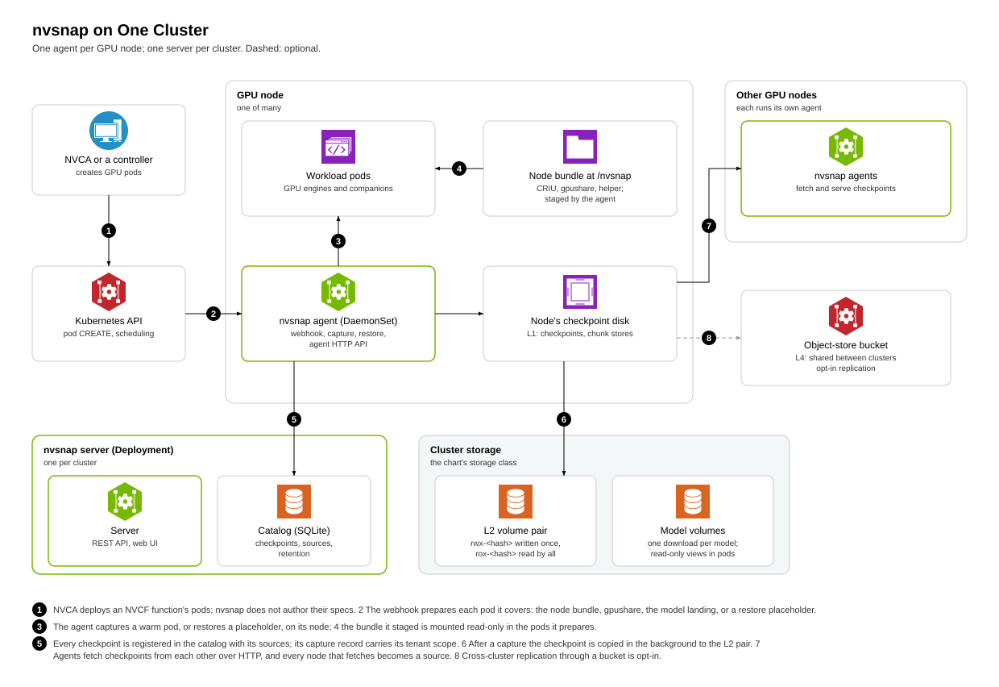

<!--
SPDX-FileCopyrightText: Copyright (c) 2026 NVIDIA CORPORATION & AFFILIATES. All rights reserved.
SPDX-License-Identifier: Apache-2.0
-->
# Start here

Five minutes on what nvsnap is, how it works, what it has measured, and what
it is not. Words are defined in the [glossary](GLOSSARY.md).

<!-- toc: generated by scripts/docs/docs-toc.py; edit the headings, not this list -->
**Contents**

- [The problem](#the-problem)
- [How nvsnap solves it](#how-nvsnap-solves-it)
- [Measured numbers](#measured-numbers)
- [What nvsnap is not](#what-nvsnap-is-not)
- [Where next](#where-next)
<!-- /toc -->

## The problem

A large model's inference server takes minutes to become ready: it downloads
the weights, loads them onto the GPUs, compiles kernels and captures CUDA
graphs. Every new replica pays that again, so scaling out is slow exactly when
it is needed.

## How nvsnap solves it

nvsnap captures a replica once it is serving and starts later replicas of the
same configuration from that capture. It works on unmodified images, through
an agent on every GPU node and an admission webhook that prepares pods. A
cluster uses one of two capture methods: **cachedir** captures the model and
the engine's compile caches, so a new replica skips the download and the
compilation; **criu** checkpoints the serving processes themselves, GPU memory
included, so a new replica resumes them. Multi-GPU and multi-node engines are
checkpointed with gpushare, which handles the GPU memory their processes
share. Checkpoints reach other nodes through cluster storage and from peer
agents.

## Measured numbers

Every measured number, with its model, GPUs, nvsnap version, date and raw data, is in
[BENCHMARKS.md](BENCHMARKS.md). What runs and what is refused is in [SUPPORT.md](SUPPORT.md).

## What nvsnap is not

- Not a model cache or registry: it captures a running configuration and only
  restores the same configuration on the same GPU architecture.
- Not a live migration system for serving traffic: a CRIU capture freezes
  the workload while it runs, so an instance is best captured before traffic
  reaches it.
- Not every workload shape is checkpointed: [SUPPORT.md](SUPPORT.md) lists what
  is supported, refused and not tested.

## Where next

- Install it: [operate/INSTALL.md](operate/INSTALL.md)
- How it works, with the code that enforces each rule: [ARCHITECTURE.md](ARCHITECTURE.md)
- Every number: [BENCHMARKS.md](BENCHMARKS.md); what is supported: [SUPPORT.md](SUPPORT.md)
- Every document: [README.md](README.md)
