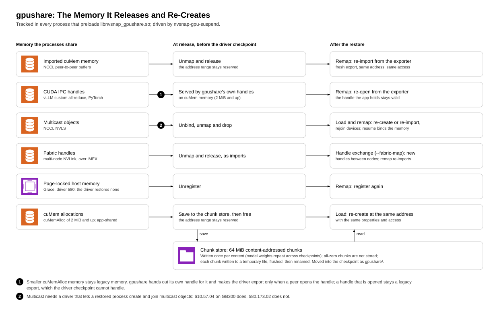
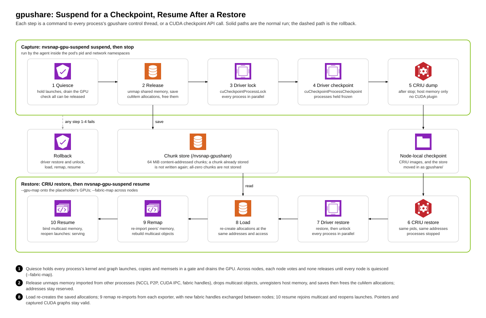
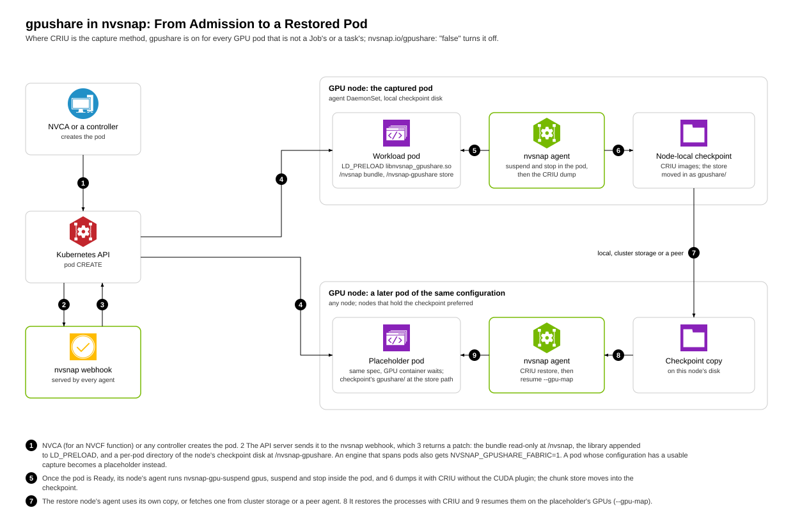

<!--
SPDX-FileCopyrightText: Copyright (c) 2026 NVIDIA CORPORATION & AFFILIATES. All rights reserved.
SPDX-License-Identifier: Apache-2.0
-->

# gpushare: checkpointing GPU memory shared between processes

`cuda-checkpoint` cannot checkpoint a process that maps GPU memory imported from
another process. Multi-GPU (tensor-parallel) workloads do this by default,
through NCCL peer-to-peer over cuMem imports, NCCL NVLS multicast objects,
CUDA IPC (vLLM custom all-reduce, PyTorch), fabric handles, and page-locked
host memory on Grace.

`libnvsnap_gpushare.so` is an LD_PRELOAD shim that tracks this memory. It
releases the memory before the driver checkpoint and re-creates it at the same
virtual addresses after restore, so pointers and captured CUDA graphs stay
valid. `nvsnap-gpu-suspend` drives the shim and the CUDA checkpoint API.



Sources: `docker/agent/gpushare/`; tests: `tests/gpushare/`. Both binaries
are built in the agent base image (`Dockerfile.base`, `gpushare-builder`
stage, CUDA 13 headers) and installed in `/criu-bundle/`. `make
check-gpushare` (and the `nvsnap gpushare` workflow) compiles them and the
tests for amd64 and arm64 with warnings as errors.

<!-- toc: generated by scripts/docs/docs-toc.py; edit the headings, not this list -->
**Contents**

- [How it works](#how-it-works)
  - [Control socket access](#control-socket-access)
- [Usage](#usage)
  - [Chunk store](#chunk-store)
- [Use through nvsnap](#use-through-nvsnap)
  - [Workloads that span nodes](#workloads-that-span-nodes)
- [Requirements and limits](#requirements-and-limits)
- [Validation](#validation)
<!-- /toc -->

## How it works

Each process that loads the shim runs a control thread on the abstract socket
`@nvsnap-gpushare.<pid>`. `nvsnap-gpu-suspend` sends it these commands
(`gpushare.h`):

| Command | Who | What it does |
| --- | --- | --- |
| `quiesce` | all pids, before any release | Holds launches, copies, memsets and stream memory operations; drains the GPU; checks that everything shared can be released. |
| `release` | all pids at once | Unmaps imported memory and multicast objects, unregisters host memory, saves the shim's cuMem allocations and the app's shared cuMem allocations to host memory or a chunk store, and frees them. |
| *(driver)* | | `cuCheckpointProcessLock` / `Checkpoint`, in parallel. |
| `load` | all pids at once, after restore | Re-creates the saved allocations at the same addresses, with the same properties and access. |
| `remap` | each pid | Re-imports peers' memory and rebuilds multicast objects. |
| `resume` | each pid | Binds multicast memory and reopens launches. |

If any step of `suspend` fails, the tool undoes the driver lock or checkpoint,
then runs `load`, `remap` and `resume`, so the workload runs on as before, and
reports whether the rollback worked.



The shim backs `cuMemAlloc` of 2 MiB or more with exportable cuMem
allocations, so CUDA IPC works across a restore. Because cuMem memory is
reachable only from devices granted with `cuMemSetAccess`, the shim follows
`cuCtxEnablePeerAccess` and `cuCtxDisablePeerAccess` and grants each peer
access; each allocation is saved and loaded on its own device.

Smaller allocations stay legacy memory, and the driver checkpoint (610)
crashes a process that holds a legacy IPC export. So the shim hands out its
own handle for legacy memory and makes the driver export only when a peer
opens the handle (asking the exporter over the control socket). This covers
vLLM's custom all-reduce signal buffer, which multi-node mode never opens. A
handle that is opened stays a legacy export, which the driver still cannot
checkpoint.

### Control socket access

Abstract sockets have no file permissions: any process in the pod's network
namespace (with `hostNetwork`, the whole node) can connect. The control thread
checks the peer's credentials (`SO_PEERCRED`) and serves only a peer in the
workload's pid namespace running as root or as the workload's user. Clients
(the shim and `nvsnap-gpu-suspend`) talk to a socket only if it belongs to the
pid in its name. So:

- `nvsnap-gpu-suspend` must run in the workload's pid and network
  namespaces (`kubectl exec`, or `nsenter -t <pid> -p -n`).
- All processes that share GPU memory must be in one pid namespace.

## Usage

The workload runs with `LD_PRELOAD=/path/to/libnvsnap_gpushare.so`. Pass
`nvsnap-gpu-suspend` every pid of the workload: the API server, the engine and
all tensor-parallel ranks.

```sh
# In place: free the GPUs, keep the processes paused, then resume.
nvsnap-gpu-suspend suspend <pids...>
nvsnap-gpu-suspend resume <pids...>

# For CRIU: save GPU memory to a chunk store, hand off to CRIU, and restore
# elsewhere. Record which GPUs the checkpoint used, for --gpu-map.
nvsnap-gpu-suspend gpus /ckpt/<id>/gpus
nvsnap-gpu-suspend --store /ckpt/store --ckpt-dir /ckpt/<id> --cache /cache suspend <pids...>
nvsnap-gpu-suspend stop <pids...>          # then: criu dump
# ... criu restore (in a new pod or on another node) ...
nvsnap-gpu-suspend --gpu-map /ckpt/<id>/gpus --cache /cache resume <pids...>

# Node cache: fill it, ahead of a restore or in the background after one,
# and evict from it.
nvsnap-gpu-suspend cache-prefetch /ckpt/store /ckpt/<id> /cache
nvsnap-gpu-suspend cache-gc /cache <max-GiB>
```

### Chunk store

Saved GPU memory is stored as 64 MiB content-addressed chunks under
`<store>/chunks/xx/<hash>`:

- A chunk already in the store is not written again, so model weights that
  repeat across checkpoints are stored once. All-zero chunks are not stored.
- Each chunk is written to an exclusively created temporary file, flushed
  with `fdatasync` and renamed, so writers in other pods can share a store and
  a crash never leaves a chunk name pointing at partial data.
- Chunk files use `O_DIRECT`, falling back to buffered I/O when a filesystem
  accepts `O_DIRECT` but fails the I/O.

`release` creates the store and `<ckpt-dir>` if missing (their parents must
exist). `<ckpt-dir>/gpu-<pid>.chunks` lists the chunks each checkpoint uses.
The CRIU image then holds only host process memory.

The optional node cache (`--cache`) is a local directory with the same layout.
Saves copy chunks into it and loads read it first. A load that misses reads
the store and does not fill the cache, since cache writes would slow the
restore; `cache-prefetch` fills it and `cache-gc` evicts least-recently-used
chunks.

Trust: chunks are named by a fast, non-cryptographic 128-bit hash and a load
trusts the name, so whoever can write a store or cache can make another
workload restore wrong data (a cryptographic hash would not stop a writer
storing wrong data under the right name). So:

- Only a workload whose checkpoint every restoring workload already trusts
  may write to a store; restores mount it read-only. A store inside a
  checkpoint's own volume, written by the checkpointed pod, adds no trust
  beyond the checkpoint itself.
- Workloads not trusted by the same restores need separate stores, which do
  not deduplicate against each other.
- A pod saving with `--cache` writes the cache, so give each such store its
  own cache directory, or let only a trusted process fill it with
  `cache-prefetch`, mount it read-only in workloads, and pass `--cache` to
  `resume` only.

## Use through nvsnap

Where CRIU is the capture method (`agent.captureMethod: criu`), the webhook
runs every GPU pod under gpushare unless the pod runs to completion (a Job's
or a task's) or is annotated `nvsnap.io/gpushare: "false"`; elsewhere,
annotate the pod `nvsnap.io/gpushare: "true"` (`internal/webhook/gpushare.go`
`gpushareMode`). nvsnap then does the steps in Usage itself, around its
criu-v2 capture and restore.



At admission, the webhook changes every container that requests GPUs: it
mounts the node bundle read-only at `/nvsnap` and appends
`/nvsnap/libnvsnap_gpushare.so` to `LD_PRELOAD` (keeping the pod's value), and
mounts a per-pod directory of the node's checkpoint disk, keyed by pod uid, at
`/nvsnap-gpushare` (the chunk store), so pods never see each other's saved
memory. Because the store volume is the node's directory of every pod's
store, a pod that mounts `nvsnap-gpushare-store` anywhere else (init and
ephemeral containers included), has its own volume of that name, or sets a
second `NVSNAP_POD_UID` gets neither the library nor the store.

At capture, the agent finds the dumped session's processes that load the
shim, runs `nvsnap-gpu-suspend gpus`, `suspend` and `stop` inside the pod's
namespaces, and dumps with CRIU without the CUDA plugin and with
`--image-io-mode direct`. It moves the chunk store into
`<checkpoint>/gpushare` and records the pids, store path and shim path in the
checkpoint metadata. A process that uses the GPU without the shim fails the
capture.

At restore, the placeholder mounts the bundle at the shim's path and the
checkpoint's `gpushare` directory at `/nvsnap-gpushare` (the agent's
generated placeholder and the e2e templates do both). The agent runs CRIU,
then `nvsnap-gpu-suspend resume` with the checkpoint's GPU map, limited to the
placeholder's GPUs (`NVIDIA_VISIBLE_DEVICES`).

Limits of the integration:

- An `LD_PRELOAD` set from a ConfigMap or Secret reference cannot be extended
  at admission; that container runs without the shim. One set only by the
  image (Dockerfile `ENV`) is invisible at admission and is replaced.
- One capture per workload at a time; a second request is refused.
- Per-pod store directories are emptied when a capture collects them; the
  agent's reaper removes the store of a pod no longer on the node
  (`internal/agent/gpushare_store_reaper.go`).
- `<checkpoint root>/gpushare-pods/` holds the stores of running pods and
  must survive any cleanup of the checkpoint root: deleting a pod's directory
  leaves its store mount on an unlinked directory, and its next capture fails
  with "No such file or directory".
- Only processes that load the shim and use the GPU are suspended; helper
  processes that inherit the preload but hold no CUDA state are dumped as
  they are.

### Workloads that span nodes

A workload whose ranks share memory over multi-node NVLink runs one pod per
node, and their tools must vote on the quiesce and exchange fabric handles
(`--fabric-map`, under Requirements and limits). nvsnap drives that as a
fabric session:

1. The webhook turns fabric on for a pod whose engine spans pods (a
   multi-node flag, or a group of more than one pod) and sets
   `NVSNAP_GPUSHARE_FABRIC=1` unless the container's `env` list names it;
   `nvsnap.io/gpushare-fabric` overrides the webhook's choice, and a value in
   the container's `env` list wins over both. The webhook does not read
   `envFrom` or the image: a value set only there is overridden by the
   injected `1` (`internal/webhook/gpushare.go` `gpushareMode`,
   `gpusharePatches`).
2. Ask any agent for a group checkpoint of all the pods:

   ```bash
   curl -X POST http://<agent>:8081/v1/gpushare/group-checkpoint \
     -H "Authorization: Bearer $TOKEN" -d '{
       "leaveRunning": true,
       "members": [
         {"namespace": "llm", "podName": "vllm-0"},
         {"namespace": "llm", "podName": "vllm-1"}
       ]}'
   ```

That agent starts each member's checkpoint on its node with a new session id.
Each member's agent creates a fresh session directory in the pod's store,
passes it as `--fabric-map`, and serves it at
`/v1/gpushare/fabric/<session>/<namespace>/<pod>`. The driving agent answers
each vote round (`go` once every member is quiesced, `retry` otherwise) and,
once every member has written its handle list, delivers the concatenated lists
to all of them, once. A fresh directory per session means a list from an
earlier cycle is never merged.

`leaveRunning: true` suspends and resumes the instance in place around the
dump. `leaveRunning: false` dumps it for a move: the processes stop, and the
dump's network lock keeps the source pods from sending resets until they are
deleted. Each checkpoint records its pod's IP and index in the instance.

Limits of the group checkpoint:

- If a member's checkpoint ends before the vote passes, later votes are
  answered `abort`; the tool treats that as `retry` and rolls back at its own
  timeout (`--timeout-ms`, 120 s here), not at once.
- A member whose dump fails still resumes and takes part in the exchange. A
  member that returns without writing a handle list is left out; the others
  resume among themselves.

#### Moving an instance to new pods

A group restore keeps the TCP connections between the instance's pods (NCCL
bootstrap, Gloo, ZMQ, TCPStore) although every new pod has a new IP:

```bash
curl -X POST http://<agent>:8081/v1/gpushare/group-restore \
  -H "Authorization: Bearer $TOKEN" -d '{
    "members": [
      {"checkpointId": "<id of vllm-0>", "placeholderNamespace": "llm", "placeholderPodName": "vllm-0-r"},
      {"checkpointId": "<id of vllm-1>", "placeholderNamespace": "llm", "placeholderPodName": "vllm-1-r"}
    ]}'
```

1. The driving agent waits until every target pod has its IP, makes each
   checkpoint local on its target node and reads its metadata there. The
   checkpoints must be the complete set of one group checkpoint, one per
   target pod.
2. It builds one address map for the instance, `OLD1=NEW1,OLD2=NEW2,...`.
3. Every member restores with `criu restore --inet-addr-map <map>
   --keep-network-lock`, so a pod restored early cannot reach a peer that is
   not restored yet.
4. Each member then runs the GPU resume, with the handle exchange, its GPU
   launches held by the hold gate, and reports restored.
5. Once every member is restored, the driver gives the unlock verdict; each
   member opens its gate, then releases its network lock (`criu net-unlock`
   in its network namespace) (`internal/agent/restore_v2.go`, `awaitUnlock`,
   `openHeldGPUOnUnlock`).

If any member fails, the others abort and the driver deletes every target pod
(`keepFailedPods: true` keeps them): a pod holds its lock until its network
namespace goes away.

Limits of the move:

- Only connections between the instance's pods survive, because every pod
  restores with the same map. Others (API clients, Services) are reset after
  the unlock and the application must reconnect. A connection opened later to
  a remembered old address (`MASTER_ADDR`) fails.
- A connection with data waiting to be sent can take about as long as the
  hold lasted, up to about 2 minutes, to send again. Members wait at most 10
  minutes for the unlock; TCP drops a connection held longer than about 13
  minutes.
- Requires a CRIU with `--inet-addr-map` and `net-unlock` (base image
  v0.0.26 or later); the restore refuses to start otherwise.

## Requirements and limits

- Driver 610 or later (validated: 610.57.04). Driver 580 cannot restore
  multicast (NVLS) objects: `cuMulticastAddDevice` fails after a restore
  (GB300 with 580.173.02, H100 with 580.126.16), so tensor-parallel vLLM on
  NVSwitch systems fails at `remap` (NCCL NVLS, PyTorch symmetric memory and
  FlashInfer's all-reduce fusion use multicast). On x86 with 580.126.16 (RTX
  PRO 6000), the driver's own restore of processes sharing GPU memory (vLLM
  TP=2) fails with `CUDA_ERROR_UNKNOWN`.
- Exported fds the app keeps: after `release`, every fd referring to memory
  the process exported is pointed at `/dev/null` (numbers stay valid) so CRIU
  can dump it. Fds received from another process and kept are not covered.
- IMEX and fabric handles. Fabric handles need the process's driver clients
  subscribed to an IMEX channel; a driver restore drops the subscription and
  libcuda does not renew it, so fabric create, import and multicast fail with
  `NOT_PERMITTED`. The shim watches libcuda's ioctls and subscribes each root
  client the restore creates (`NV0000_CTRL_CMD_CLIENT_SUBSCRIBE_TO_IMEX_CHANNEL`),
  and again at `load`. Because the restore also closes the OS-event device
  file libcuda waits on for cross-node imports, the shim registers its own and
  has libcuda wait on it (`poll`/`ppoll` on fd -1), closing it at `release`.
  Memory shared as fabric handles is copied into a new allocation at `load`
  before it is exported again. Fabric-capable memory still cannot be exported
  as a POSIX fd after a restore, and with an IMEX channel NCCL, PyTorch and
  FlashInfer create such memory even on one node. So by default the shim
  hides fabric support (`CU_DEVICE_ATTRIBUTE_HANDLE_TYPE_FABRIC_SUPPORTED`
  reads 0; fabric `cuMemCreate` and `cuMulticastCreate` fail with
  `NOT_PERMITTED`), and those libraries fall back to POSIX fds.
  `NVSNAP_GPUSHARE_FABRIC=1` keeps fabric support, which multi-node NVLink
  needs; fabric-shared memory is then re-imported as fabric handles.
- Multi-node NVLink: fabric handles change across a restore, and a node must
  not release memory while another node's kernels read it. So
  `nvsnap-gpu-suspend --fabric-map DIR` (on `suspend` and `resume`, on every
  node) coordinates the nodes through whoever drives them:
  - Quiesce vote: each attempt, the tool writes `DIR/q` (`<attempt> ok` or
    `<attempt> busy`) and waits for `DIR/d`; once every node has voted the
    driver writes `<attempt> go` if all are quiesced, else `<attempt> retry`.
  - Handle exchange: after `load`, the tool writes its new fabric handles to
    `DIR/out` and waits for `DIR/in` (all nodes' `out` files concatenated) to
    re-import from at `remap`. The driver must remove `DIR/out` and `DIR/in`
    before `resume`, or a stale list from the previous cycle is merged.
- Scope: exporters on the same node are found among the processes in the
  same pid namespace.
- Shared allocations of the app: on 610.57.04 the driver checkpoint fails
  with `CUDA_ERROR_OUT_OF_MEMORY` on some app-created cuMem allocations
  (FlashInfer's 512 MiB multi-node all-reduce workspace), and will not export
  an allocation of 512 MiB or more that a restored process created before its
  checkpoint (`INVALID_VALUE`). So the shim saves and frees at `release` every
  app allocation that is shared (POSIX fd or fabric handle) and mapped once
  from offset 0, and re-creates it at `load` at the same address with the
  same properties and access. An allocation mapped more than once is left to
  the driver; when a peer's re-import of it fails, the shim copies its
  contents into a new allocation at the same address.
- `hostNetwork`: such pods share abstract socket names. If two run a process
  with the same pid, the second cannot bind its control socket and its
  checkpoint is refused.
- glibc 2.17 or later in the workload image: the shim and the tool run in the
  workload's container (built on Rocky Linux 8 against the oldest symbol
  versions; the build check enforces the floor). Images without glibc (musl,
  distroless static) cannot load the shim.
- Held calls: while suspended, the shim holds launches, copies, memsets and
  stream memory operations made through the CUDA runtime or the driver's
  entry-point lookup (as PyTorch, NCCL and vLLM do). Not held: copies to or
  from CUDA arrays, managed-memory prefetches, batched copies
  (`cuMemcpyBatchAsync`), and calls a program links directly against
  `libcuda`.
- State files: the tool keeps state in `/tmp/nvsnap-gpu-suspend` and refuses
  to run if it exists and is not owned by its user with mode 0700.
- Host memory: without `--store`, saved GPU memory is kept in host RAM; size
  the pod's memory limit for it.
- Store garbage collection is not implemented. A store only grows: delete a
  checkpoint's directory and the chunks no remaining `gpu-*.chunks` list
  names. Temporary files a crash leaves in a store are not removed.
  `cache-gc` covers the node cache only.
- RDMA and MPTCP: a workload holding RDMA devices (`/dev/infiniband/uverbs*`,
  `rdma_cm`) or an MPTCP socket at capture cannot be captured; CRIU cannot
  dump them (checkpoint-restore/criu#267), and RDMA state (memory
  registrations in a NIC context, queue pairs connected to peers) would not
  survive a restore anyway. gpushare does not touch RDMA. The capture
  preflight blocks such a capture and the instance runs on and starts cold
  (ARCHITECTURE.md, "Who is captured"; MPTCP support: #2926). This covers,
  for example, ModelExpress peer-to-peer over RDMA (NIXL/UCX) and NCCL over
  InfiniBand or RoCE. A workload that has released its RDMA devices by
  capture time is not blocked.

## Validation

All results are with vLLM 0.20.0 at default flags on 4x GB300 with driver
610.57.04 unless noted, recorded between 2026-10-05 and 2026-10-09; the nvsnap
build is not recorded. In every case the output after restore matched the
output before the checkpoint byte for byte.

In-place suspend and resume, Qwen2.5-7B-Instruct, TP=4: 3 of 3 cycles passed,
each suspend about 6.5 s and each resume about 5.9 s. The same passed in a pod
with an IMEX channel (a ComputeDomain), with NCCL NVLS and FlashInfer's
all-reduce fusion active, both by default and with `NVSNAP_GPUSHARE_FABRIC=1
NCCL_MNNVL_ENABLE=1` (memory and multicast shared as fabric handles, as across
nodes).

Checkpoint on one node and restore on another, Qwen2.5-72B-Instruct, TP=4,
store on a network block storage PVC, node cache on local NVMe:

| Phase | Restore from the store | Restore from the node cache |
| --- | --- | --- |
| New pod to first token | 87.8 s | 66.7 s |
| GPU memory load | 30.1 s | 7.7 s |
| `criu restore` (processes, host memory) | 18.0 s | 18.3 s |

The first checkpoint wrote 159 GiB to the store, a second checkpoint of the
same model 20 GiB. A cold start of the same model took 363 s to the first
token including a 136 GB model download, 242 s without it.

Across 2 nodes (4x GB300 each, one NVLink domain, an IMEX channel):

- 8 ranks running a checked 256 MB NCCL all-reduce with
  `NCCL_MNNVL_ENABLE=1` (NVLS multicast across nodes): in-place suspend and
  resume with `--fabric-map`, 3 of 3 cycles passed, one after a retried vote.
- vLLM with Qwen2.5-14B-Instruct, TP=8 (`--nnodes 2`,
  `NVSNAP_GPUSHARE_FABRIC=1 NCCL_MNNVL_ENABLE=1`): output identical to the
  baseline in 5 of 6 cycles; the sixth merged a stale `DIR/out` from the
  previous cycle and resumed when rerun with the right lists.
- A 1-trillion-parameter MoE model on a vLLM build with multi-node custom
  all-reduce and FlashInfer's multi-node all-reduce fusion, TP=8 (about 266 GB
  of GPU memory per rank, saved to a chunk store): 3 of 3 in-place cycles in a
  row passed with output identical to the baseline.

On 4x H100 with driver 580.126.16, Qwen2.5-7B-Instruct TP=4 was dumped with
CRIU, restored into a new pod and answered as before, with the three
multicast users off (`NCCL_NVLS_ENABLE=0`, `VLLM_ALLREDUCE_USE_SYMM_MEM=0`,
`fuse_allreduce_rms` false in the compilation config's `pass_config`).

The GPU tests in `tests/gpushare/` pass on GB300 (driver 610) and RTX PRO 6000
(x86, driver 580): `test_multi_gpu` (one process, two GPUs, peer access),
`test_export_copies` (an app keeping its exports' fds), `test_large_export`
(a shared 512 MiB allocation), `test_ipc_legacy` (an unopened IPC handle of
small legacy memory). `test_ipc_release` and `test_cumem_release` probe the
driver without the shim: on both platforms it cannot checkpoint or re-export
memory shared through its own CUDA IPC, which is why the shim replaces it.

To reproduce: `tests/gpushare/k8s/vllm_criu_bench.sh` (see its header) and
`tests/gpushare/k8s/vllm_ckpt_cycle.sh`.
