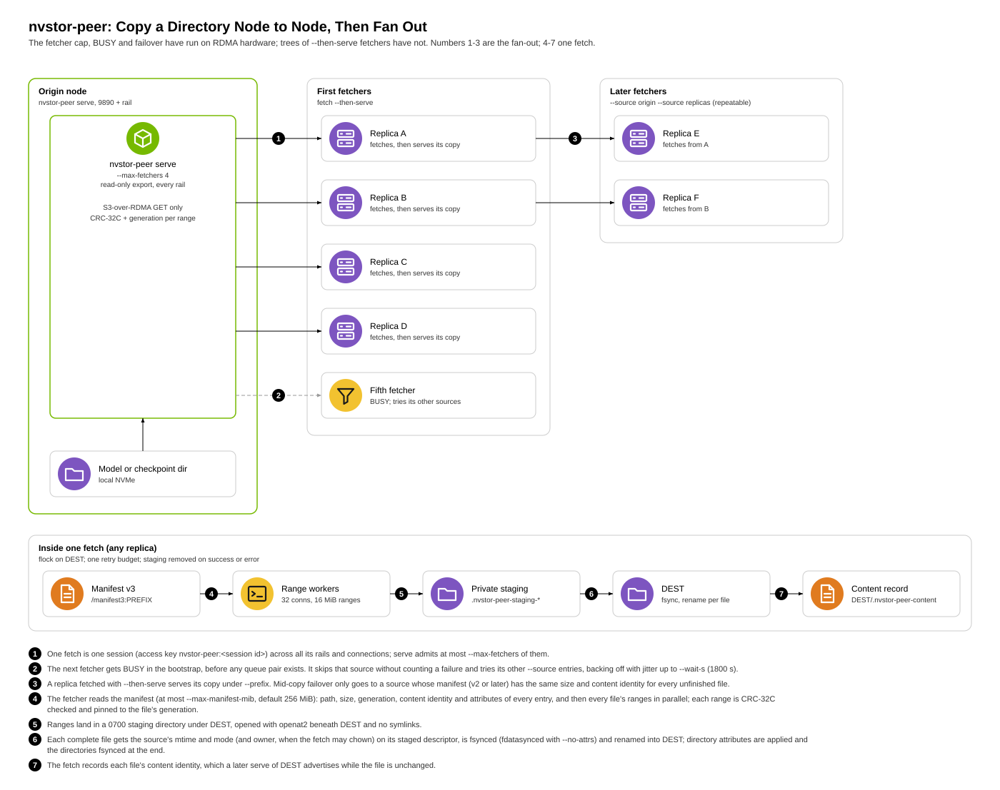

# nvstor-peer: copy a directory between nodes over RDMA

`nvstor-peer` copies a directory tree (a checkpoint, a model's weights)
from the node that has it to the node that needs it, over RDMA, with no
storage tier in between. One process serves a local directory read-only;
another fetches it into a local directory. Crate: `crates/nvstor-peer`.
Status: stable.

- `serve` exports a directory through the S3-over-RDMA server
  (`nvstor_rdma::s3_rdma::S3RdmaServer::read_only`), one transport per
  RDMA NIC ("rail"), so every rail serves.
- `fetch` asks the server for its rails, spreads its connections over
  them, each on the local NIC that reaches that rail, fetches the file
  list, then pulls every file's ranges in parallel into the destination.
- `bench` runs the fetch data path without a destination, to measure the
  transport and the server.
- Fan-out: a `serve` takes at most `--max-fetchers` (default 4) fetchers
  at once and tells the rest BUSY before creating any QP; a `fetch` takes
  several sources, moves on from busy or dead ones, and `--then-serve`
  turns a finished copy into a source. Many replicas then copy as a tree
  instead of all landing on one NIC. See
  [Fan-out](#fan-out-many-fetchers-one-origin).
- `fetch --gpu N` lands the copy in GPU memory first (GPUDirect RDMA) and
  writes the disk copy in the background. See
  [Fetch into GPU memory](#fetch-into-gpu-memory-fetch---gpu-n).



It shares the transport and the range-fetch contract with
`s3_hydrate` ([`model-hydration.md`](model-hydration.md)); the fetcher is
generic over `nvstor_rdma::hydrate::RangeSource`.

Copy speed: a fetch is normally bounded by its destination side (writing
each range into its destination file), not by the transport. `bench`,
which runs the same transport with no destination, moves considerably
more than a fetch on the same nodes. On tmpfs, the kernel takes a file's
inode lock for each write, so workers writing the same file serialize.

## Usage

Both sides need the same secret, at least 16 characters, in
`NVSTOR_PEER_SECRET`.

```sh
# source node
NVSTOR_PEER_SECRET=... nvstor-peer serve --root /var/lib/models

# destination node
NVSTOR_PEER_SECRET=... nvstor-peer fetch --source SOURCE_IP:9890 \
    --dest /nvme/models/llama-70b --prefix llama-70b

# destination node that then serves its copy to the next ones
NVSTOR_PEER_SECRET=... nvstor-peer fetch --source SOURCE_IP:9890 \
    --source peers.example:9890 --dest /nvme/models/llama-70b \
    --prefix llama-70b --then-serve
```

`serve` flags:

| Flag | Default | Meaning |
|---|---|---|
| `--root DIR` | required | Directory to export, read-only |
| `--export-as PREFIX` | none | Serve DIR as the directory PREFIX: file `x` is `PREFIX/x` (what `--then-serve` does with `--prefix`) |
| `--port P` | 9890 | Bootstrap port of rail 0; rail k listens on P + k |
| `--listen ADDR` | `::` | Address the bootstrap listeners bind. `::` takes IPv4 and IPv6 (dual stack, so a fetcher may name this node by either; IPv4 only on a host without IPv6); a specific address restricts them to it. Also taken by `fetch --then-serve`. See the note on exposure under [Authentication and access](#authentication-and-access) |
| `--devices SEL` | `netns` | `netns` (devices that belong to this network namespace, i.e. a pod's own VFs; see below), `all`, or a list such as `mlx5_0,mlx5_1` |
| `--max-fetchers K` | 4 | Fetchers served at once; more are told BUSY (see Fan-out) |
| `--slot-mib N` | 16 | Size of each registered buffer slot, the largest range served |
| `--slots N` | 64 | Slots per rail |
| `--max-in-flight N` | 256 | Requests in progress across all rails |
| `--ready-file PATH` | none | Written once every rail listens; removed at start |

`fetch` flags:

| Flag | Default | Meaning |
|---|---|---|
| `--source HOST:PORT` | required, repeatable | A server's rail-0 bootstrap address. A name that resolves to several addresses (a headless Service) is several sources; names are resolved again on every selection round. `--from` is the same flag |
| `--dest DIR` | required | Destination directory (created if missing) |
| `--prefix SUBDIR` | whole export | Copy only this directory of the export |
| `--connections N` | 32 | Parallel workers, one connection each |
| `--range-mib N` | 16 | Bytes per request (capped by the server's slot size) |
| `--devices SEL` | `netns` | As for `serve` |
| `--no-direct` | off | Write buffered instead of O_DIRECT |
| `--max-manifest-mib N` | 256 | Largest file list accepted from the server |
| `--wait-s S` | 1800 | Longest wait for a source to take the fetch while all are busy or unreachable, at the start or after losing one |
| `--client-name NAME` | host name | Seeds this fetcher's source order and backoff jitter |
| `--ready-file PATH` | none | Written when the copy is complete (with `--then-serve`: and served); holds the content digest. Removed at start |
| `--no-attrs` | off | Copy bytes only: no modes, mtimes or owners. Files stay 0600 and created directories 0700 (the caller sets modes). Also lets a fetch take a source that runs an older nvstor-peer, which is refused otherwise |
| `--no-owner` | off | Modes and mtimes, but not owners: the files are the caller's even with CAP_CHOWN (for a user namespace without the ids mapped, or NFS with root_squash, where a chown fails) |
| `--preserve-setid` | off | Keep set-user-ID and set-group-ID bits of files and directories (dropped by default) |
| `--json` | off | Print one JSON object on stdout at the end, on failure too; human output goes to stderr (see [Stable interface](#stable-interface)) |
| `--then-serve` | off | After a complete copy, serve DEST as `--prefix` with the same secret and devices; takes `--port`, `--listen`, `--max-fetchers`, `--slot-mib`, `--slots`, `--max-in-flight` as `serve` does (without `--then-serve` these are refused) |
| `--gpu N` | off | Land the copy in GPU N's memory first; see [Fetch into GPU memory](#fetch-into-gpu-memory-fetch---gpu-n). `--gpu-mapping`, `--gpu-ready-file` and `--gpu-check` require it |

Which attributes a copy gets, and when an owner or mode counts as
authoritative: [Attributes](peer-copy-internals.md#attributes).

With `--devices netns` a device belongs to the namespace when its GID is
an address of an interface here or its netdev is an interface here (same
name and MAC). A VF whose routable GID has not appeared yet (SLAAC still
running when the pod starts) is waited for, up to 30 s by default
(`NVSTOR_RDMA_RAIL_WAIT_SECS=N` to change, `0` not to wait). A VF still
without one after the wait is kept, with a warning naming the device; its
GID is read again on every connection, so it carries traffic once the
address appears.

`fetch` prints one line at the end: files, GiB, seconds, GiB/s, ranges,
retries, reconnects, failovers, the source it started from, the content
digest, the attributes applied and connections per local NIC. The
attributes read `attrs mode+mtime+owner`; `attrs mode+mtime (owner kept:
no CAP_CHOWN | no CAP_DAC_OVERRIDE | no CAP_FOWNER | --no-owner | owner
not authoritative at source)`; `attrs none (--no-attrs; files 0600,
directories 0700)` or `attrs none (not authoritative at source; ...)`;
with `, setid kept` under `--preserve-setid`. Its exit code says how it
ended ([Stable interface](#stable-interface)). Two complete copies of
the same tree print the same content digest, whichever sources they came
from.

### Stable interface

What another program (nvSnap, a job script) may depend on. Changing any
of it needs a new major version of `nvstor-peer` (below 1.0, a new minor
version).

- **Flags.** `serve --root DIR --devices all --port P --ready-file PATH`
  and `fetch --source HOST:PORT` (repeatable) `--devices all --dest DIR
  --connections N`, with the meanings in the tables above. Other flags
  may change in a minor version.
- **`nvstor-peer --version`** prints `nvstor-peer VERSION (commit
  SHA)`: the version and the git commit it was built from. The version
  is the release version for a release build (the Bazel build stamps the
  release tag's version), else the crate version. The commit is `NVSTOR_PEER_COMMIT` from the build environment when set
  (the cross-build script `deploy/nfs-rdma/build-aarch64.sh` passes the
  checkout's commit, with `-dirty` when it has uncommitted changes), else
  `git rev-parse HEAD`, else `unknown`.
- **`fetch` exit codes** (`crates/nvstor-peer/src/outcome.rs`, one
  exhaustive mapping per error type, so a new error has to be given a
  code):

  | Code | `error_kind` | Meaning | What to do |
  |---|---|---|---|
  | 0 | null | The copy is complete | |
  | 1 | `other` | Anything else, including a partial copy (some files could not be requested; the rest are in place) and a ready file that could not be written | Read the message |
  | 2 | `usage` | Bad flags, a bad `--source`, `NVSTOR_PEER_SECRET` missing or shorter than 16 characters | Fix the command |
  | 3 | `auth` | Every source refused the credentials in the bootstrap: a different `NVSTOR_PEER_SECRET`. A refusal is not retried. A server's REJECT says why (a reason byte); a server that could not set the connection up says so and counts as unavailable (4), and a server too old to give a reason counts as a credential refusal | Fix the secret |
  | 4 | `unavailable` | No source could serve the copy: all busy for `--wait-s`, unreachable, failed mid-copy with no replacement, or serving a manifest this build cannot use (an older or newer version, malformed, too large); also a mix of refusing and unavailable sources | Try the next tier |
  | 5 | `integrity` | The data could not be copied intact: data that failed its CRC-32C after every retry on the sources that served it (even when the other sources were merely unreachable), a source's file shorter than its manifest says, a file that changed or vanished on the source mid-copy, sources that disagree on the content, a GPU copy that differs from the disk copy under `--gpu-check` | Re-snapshot or use another source |
  | 6 | `destination` | Local I/O failed under `--dest` (disk full, permission, not a directory), or another fetch holds the destination's lock | Fix the destination |

  `serve` and `bench` exit 0, 2 on a usage error, 1 on any other.
- **`fetch --json`** prints exactly one JSON object on one line on stdout
  when the run ends, on success and on every failure (a usage error
  included); everything else (the human summary, logs, with
  `--then-serve` the serving lines) goes to stderr. With `--then-serve`
  the line is printed once serving has started and the ready file is
  written; if serving cannot start, the line reports that failure
  (exit 1, `other`, with the copy's counts). A process killed by a
  signal, or one that panics, prints no JSON line: treat a missing line
  as a failure of kind `other`.

  ```json
  {"ok":true,"exit_code":0,"error":null,"error_kind":null,"files":<n>,
   "bytes":<n>,"seconds":<s>,"retries":0,"reconnects":0,
   "failovers":0,"source":"<host:port>","content_digest":"<hex>",
   "attributes":"mode+mtime+owner","setid_kept":false,"setid_cleared":0,
   "gpu":null,"gpu_bytes":null,"gpu_ready_seconds":null,
   "version":"<version>","commit":"<sha>"}
  ```

  (wrapped here; one line on stdout). `error` is the message and
  `error_kind` the kind from the table, both null on success.
  `attributes` is what the summary line shows after `attrs` (which
  attributes the copy was given, and if not, why); `setid_kept` and
  `setid_cleared` as there. `gpu`, `gpu_bytes` and `gpu_ready_seconds`
  are null without `--gpu`. On failure the counts are what is known: an
  incomplete copy reports what it copied (with its `attributes`), other
  failures 0 and `attributes` null; `source` and `content_digest` are
  empty when no source was reached. `seconds` has millisecond resolution.
  Fields may be added in a minor version; none is removed or changes
  meaning without a major one.

## Rails, pairing and routes

`nvstor-peer` itself needs no routes, and no `NET_ADMIN`, to pair rails
or to connect them. Pairing without routes has been validated on RDMA
hardware (several RoCE NICs per node, one /32 per rail, pods without
`NET_ADMIN`): every source rail paired with the local rail on its plane
and no traffic crossed planes. The fabric may still need routes on some
clusters; this section says when, how to check, and the fix.

**Pairing.** A fetcher pairs each source rail with a local rail on the
same plane (`crates/nvstor-rdma/src/rail.rs`), then spreads connections
by load among the local rails that tie:

1. the routing table: the source rail's address is on a subnet attached
   to the local rail (on-link), else a route other than the default goes
   through it (a default route is no evidence: it would put everything on
   the front-end NIC);
2. otherwise the plane, by address. The source's rails (its RAILS reply)
   are clustered into planes by shared leading bits (single linkage),
   keeping the split with the widest gap between rails within a plane and
   rails of different planes; a plane must leave at least 8 host bits.
   For example, rails numbered `10.0.0.0/19`, `10.0.32.0/19`,
   `10.0.64.0/19`, ... split at /19, and a source with two NICs on one
   plane still splits correctly. A local rail sharing at least the plane
   prefix with the source rail is on its plane; every local rail on it
   ties. When the gap is under 4 bits (rails numbered within one subnet,
   say) planes are unknown: connections spread by load and the fetcher
   warns once per source rail.
3. The first connection to a source, before its rail list is known, ranks
   local rails by the raw shared prefix with the source's rail 0 (and does
   not warn).

Whatever the ranking says, a connection that cannot work does not stay:
each new connection is checked with one request (RAILS) before it is
used, and when the QP cannot reach RTR (no route or neighbour), the
source cannot set up its side, or the request is never acknowledged
(retry-exceeded, timeout), the next local rail is tried, each at most
once. A pair that failed is ranked last for the rest of the process; one
that worked is preferred among equals; the log names the pair that
worked. When no local rail connects, the error names every attempt.

**Connecting (RTR).** When a QP is moved to RTR the Linux kernel
resolves the peer's MAC from the GIDs, bound to the source GID's netdev
and address: `_ib_modify_qp` → `ib_resolve_eth_dmac`
(`drivers/infiniband/core/verbs.c`) → `rdma_addr_find_l2_eth_by_grh` →
`rdma_resolve_ip` with `resolve_by_gid_attr`
(`drivers/infiniband/core/addr.c`), which sets the netns and output
interface to the GID's netdev (`set_addr_netns_by_gid_rcu`) and looks up
with that interface and the GID's address as source (`addr4_resolve`,
`addr6_resolve`).

- IPv4: next hops through other interfaces are skipped
  (`fib_lookup_good_nhc`, `net/ipv4/fib_trie.c`), and with nothing left
  the kernel treats the destination as on-link through the rail
  (`net/ipv4/route.c`) and ARPs for it there.
- IPv6: with the source address set the lookup is not strict; routes
  through the rail score higher (`rt6_score_route`,
  `net/ipv6/route.c`), so the rail's own router-advertised default is
  normally used.

**TCP.** Bootstrap and liveness connections go to the `--source` host at
each rail's port, never to a rail address (`rdma_sources::rail_addrs`),
so they follow the host's normal routes.

**When the fabric still needs routes:**

- **Strict reverse-path filtering on the peer (IPv4).** With
  `rp_filter=1` a node drops ARP requests and packets from a rail address
  it would route through another interface: with a /32 per rail and no
  rail routes, that is every peer rail. RTR then times out. Check on
  both ends: `sysctl net.ipv4.conf.all.rp_filter
  net.ipv4.conf.<rail>.rp_filter` (the kernel uses the larger of the
  two; 1 is strict, 2 loose, 0 off). `serve`, `fetch` and `bench` log one
  warning at start when a rail of their host is strict. On a flat L2
  rail network strict filtering may not drop anything; where it does,
  set `rp_filter` to 2 on the rails (or `all`), or add per-rail routes.
- **IPv6 lookups that leave through another interface.** Because the
  lookup is not strict, the rail's default loses to a lower-metric
  default on `eth0`, a higher router preference, a more specific route
  through `eth0`, or no (or an expired) router-advertised default on the
  rail. RTR then succeeds with `eth0`'s gateway MAC and the QP later
  fails with retry-exceeded errors. Check, for each rail:
  `ip -6 route get <peer rail address> from <this rail's address> oif <rail netdev>`
  must name the rail netdev and a gateway on it. Fix: per-rail routes to
  the peer planes through the rail (or a /128 per peer rail address, as
  `deploy/nfs-rdma/rails-mount.sh` does for NFS).

No startup check covers the IPv6 cases: answering them needs a kernel
route lookup (netlink), which `nvstor-peer` does not do.

## Measuring the path: `bench`

`bench` runs the fetch data path against a `serve` without a
destination, so the number is the transport and the server, not the
destination disk. It is the tool for measuring changes to the RDMA
transport.

```sh
# against a serve of a data set (tmpfs for the transport alone, NVMe for
# the real read path)
NVSTOR_PEER_SECRET=... nvstor-peer bench --source SOURCE_IP:9890 \
    --connections 64 --range-kib 16384 --pattern seq --duration-s 20
```

It opens `--connections` workers exactly as a fetch does (one session, one
connection per worker, spread over the source's rails, each on the local
NIC that reaches its rail, one registered slot each), connects all of them
before the clock starts, runs `--warmup-s` unmeasured, then measures for
`--duration-s`. Every range is RDMA-written by the server into the
worker's slot and CRC-32C and generation checked, then discarded. `seq`
hands out the data set's ranges from one shared cursor, file by file
(wrapping); `rand` picks ranges uniformly. Only ranges that start and end
inside the measured window count. Any failed range voids the run: it
exits 1 with the error.

| Flag | Default | Meaning |
|---|---|---|
| `--source HOST:PORT` | required, repeatable | As for `fetch`; the first source that opens is measured |
| `--prefix SUBDIR` | whole export | Read the files under this directory |
| `--connections N` | 32 | Parallel workers, one connection each |
| `--range-kib N` | 16384 | Bytes per request, a multiple of 4; capped by the server's slot size |
| `--pattern seq\|rand` | `seq` | Sequential (shared cursor) or uniformly random ranges |
| `--warmup-s S` | 3 | Unmeasured time after every connection is up |
| `--duration-s S` | 20 | Measured window |
| `--devices SEL` | `netns` | As for `serve` |
| `--max-manifest-mib N` | 256 | As for `fetch` |
| `--client-name NAME` | host name | Seeds the random ranges |
| `--json` | off | Print one JSON object instead of the summary line |

Output: GiB/s, ranges/s, latency at p50, p99 and p99.9 and the maximum
(log-linear histogram, within 6.25 %), this process's CPU time over the
window and GiB per CPU-second, the data set's files and size, the source,
and connections per local NIC. Server CPU is not included; read it from the
server's cgroup (`cpu.stat`) around the run.

On a node with two CPU sockets, bind the server to the socket its NICs
are on (`numactl`): a server spread over both sockets runs slower and
less steadily.

## Into GPU memory

In Kubernetes the client pod must not be privileged: a privileged container
that is also given GPUs fails to start ("device container path that already
exists on the host"). `IPC_LOCK` is enough. How the GPU path works:
[peer-copy-internals.md](peer-copy-internals.md#gpu-memory-path).

### Measuring into GPU memory: `bench --gpu N`

With `--gpu N` every range lands in GPU N's memory instead of a host
slot: the server's RDMA WRITE goes from the NIC straight into the GPU,
with no host buffer on the way.

| Flag | Default | Meaning |
|---|---|---|
| `--gpu N` | off | GPU index in CUDA's order (`CUDA_DEVICE_ORDER=PCI_BUS_ID` makes it `nvidia-smi`'s) |
| `--gpu-mapping default\|pcie` | `default` | How the NIC reaches the memory: the driver's choice (C2C on Grace) or the GPU's PCIe BAR. Some platforms' mlx5 driver refuses `pcie` (ENOTSUPP) |
| `--no-gpu-verify` | verify | Skip the per-range check: measures the NIC-to-GPU path alone |

### Fetch into GPU memory: `fetch --gpu N`

```sh
NVSTOR_PEER_SECRET=... CUDA_DEVICE_ORDER=PCI_BUS_ID nvstor-peer fetch \
    --source SOURCE_IP:9890 --dest /data/ckpt --gpu 0 \
    --gpu-ready-file /run/ckpt.gpu.json --json
```

Every range goes from the source over the rails straight into GPU N's
memory (GPUDirect RDMA, as `bench --gpu` above), is checked there
(read back, CRC-32C), and is placed at its file's offset in one GPU
buffer. The copy in `--dest` follows in the background: each
connection's disk writer reads its ranges back from the GPU buffer and
writes them with the usual staging, fsync and rename, so the GPU copy
never waits for the disk. Design: [`design/fetch-gpu.md`](design/fetch-gpu.md).
Validated on RDMA hardware with GPUs (every file's sha256 checked against
the source, and the GPU copy compared with the disk copy).

| Flag | Meaning |
|---|---|
| `--gpu N` | Fetch into GPU N (CUDA's order; `CUDA_DEVICE_ORDER=PCI_BUS_ID` makes it `nvidia-smi`'s) |
| `--gpu-ready-file PATH` | Written once every file is in GPU memory, before the disk copy is done: one JSON object, `{"gpu","ipc_handle","bytes","files_bytes","ready_ns","files":[{"path","offset","size"}]}`. `ipc_handle` is the buffer's CUDA IPC handle (hex) for `cuIpcOpenMemHandle` in another process on the node; each file is at `offset` in it |
| `--gpu-check` | After the disk copy, compare every file's GPU copy with its disk copy (a mismatch is an integrity failure, exit 5) |
| `--gpu-mapping default\|pcie` | As for `bench` |

Lifetime: with `--gpu-ready-file`, the process holds the GPU memory after
the JSON line until it is stopped (SIGTERM), also if the disk copy failed
after the ready file was written (the JSON line says so): a consumer may
be using it. Without one, nothing can open the memory and the process
exits. A fetch that lists files the transport cannot request (paths too
long for a key) is refused before any transfer (exit 1), because the GPU
copy is all or nothing. The JSON line fills
`gpu`, `gpu_bytes` and `gpu_ready_seconds`.

The container needs the CUDA driver library: with the NVIDIA container
runtime, set `NVIDIA_DRIVER_CAPABILITIES=compute,utility` (the
`nvstor-peer-image` Bazel target does, see the README).

## Authentication and access

- **Bootstrap (`crates/nvstor-rdma/src/bootstrap.rs`).** A fetcher
  connects to a rail's TCP bootstrap port. The server sends a fresh
  32-byte challenge; the fetcher answers with its access key, its GID and
  QP numbers, and an HMAC-SHA256 over the challenge and its own message,
  keyed by `NVSTOR_PEER_SECRET`. The server creates no QP, CQ or memory
  registration until that checks out; anyone else gets REJECT. The TCP
  connection then stays open as a liveness channel: when either side
  closes it, the other tears the peer down.
- **Requests.** Every request on the RDMA connection is also HMAC-signed
  with the secret, with a timestamp and nonce checked against a
  process-wide replay guard.
- **Server memory.** The server never advertises a pool address or rkey,
  its pool is registered for local access only, and its QPs grant peers no
  remote access. Data moves only by the server RDMA-WRITING a range into
  the buffer the fetcher named in its signed request.
- **Read-only.** `serve` refuses ALLOC, PERSIST, REPLICATE and DELETE
  before admission. A fetcher can read files under `--root` and nothing
  else.
- **Sessions.** A fetch picks a random session id once and every one of
  its connections presents the access key `nvstor-peer:<id>`, covered by
  the bootstrap MAC and by every request signature. The server counts
  fetchers by session ([`--max-fetchers`](#fan-out-many-fetchers-one-origin)).
  A fetcher that presents a plain `nvstor-peer` key (no session) is
  refused.
- **Listening address.** `serve` listens on `::` by default, so its
  bootstrap ports take IPv6 as well as IPv4. On a host whose firewall has
  IPv4 rules only, they are then reachable over IPv6 without those rules.
  What anyone who can reach them gets before authenticating is a TCP
  connection and the HELLO (a random challenge, the rail's GID and lane
  count); no QP, CQ or memory exists until the secret is proven. Restrict
  with `--listen ADDR` (an address of this host, or `0.0.0.0` for IPv4
  only) or with IPv6 firewall rules.
- **Limits on connectors.** At most 64 handshakes in progress, 4096 peers,
  and 512 peers per source address per rail (an IPv4-mapped address counts
  as the IPv4 address), and at most 8 × 512 from one IPv6 /64: a host can
  use any address of its /64, while every instance of a cloud subnet may
  share one /64, so the /64 alone would make neighbours share one quota.
  A handshake that does not finish in 5 s is dropped
  (`nvstor_rdma::bootstrap::AcceptLimits`).
- Traffic is not encrypted. Anyone who holds the secret can read the whole
  export.

## Fan-out: many fetchers, one origin

- `serve --max-fetchers K` (default 4) serves at most K fetches at once and
  answers the rest BUSY before creating any QP, so many replicas starting
  together do not pile onto one NIC.
- `fetch --source` is repeatable. A fetch moves on from busy or dead
  sources, and fails over mid-copy only to a source with the same content identity
  (the same version from the same origin).
- `--then-serve` turns a finished copy into a source (below), so copies
  spread as a tree.

The cap, BUSY under slot saturation and failover from a killed source
have been validated on RDMA hardware; trees of many fetchers with
`--then-serve` have not been measured yet.

Why the cap is 4, how sources are chosen, failover timing and content
identity: [peer-copy-internals.md](peer-copy-internals.md#fan-out).

### Serve after fetch

`fetch ... --then-serve` serves DEST after a complete copy, under
`--prefix`, so a downstream fetch with the same `--prefix` asks a replica
exactly what it would ask the origin. It is `serve --root DEST --export-as
PREFIX` with the fetch's secret and devices. A replica serves only a
complete copy: an incomplete fetch exits nonzero and does not serve.
`deploy/nfs-rdma/peer-fanout.yaml` puts this together for Kubernetes: one
headless Service over every pod that is Ready to serve, replicas fetching
from that one name, readiness (and the start of the workload) gated on
the ready file.

### Measuring fan-out

To find where a NIC's connection-state knee is and how a tree behaves:

1. One source, many concurrent fetchers (8, 32, 128), `--max-fetchers
   4096` (no cap) against the default: time until all copies are
   complete, the distribution of per-fetch times, the source NIC's QP
   count (`rdma res show qp | wc -l`) and its throughput, and any
   connection-context cache counters the NIC exposes (`ethtool -S`,
   `rdma statistic`).
2. The same fetchers with `--then-serve` (the tree) and K = 2, 4, 8:
   time to N complete copies, the highest number of concurrent sessions
   any source logged (never above K), the BUSY count per source, and the
   content digest on every replica (all equal) plus sha256 of every file.
3. BUSY cost: time from TCP connect to BUSY at the client, and no QP or
   thread growth on the source from refused fetchers.
4. Failover inside a tree: `kill -9` a source in the middle of the tree
   while its fetchers copy; they must finish from other sources with
   `failovers` 1, sha256 matching, and the killed source's places freed
   (a restart of it admits K new fetchers).
5. `cargo test -p nvstor-peer --test fanout_rdma -- --ignored` on RDMA
   hardware: the second fetcher is BUSY, the first leaves, the second
   copies.

When counting server QPs: the server creates QPs on short-lived accept
threads, and once a thread exits `rdma res show qp` prints the QP with
no pid or comm; count RC QPs on the server's rail devices that have no
owner or are owned by a live server thread.

## Comparing a copy with its source

A copy holds names of nvstor-peer's own next to the copied files; they
are never listed, served or copied on. Leave them out when comparing a
copy with its source:

| Where | Name | When |
|---|---|---|
| DEST | `.nvstor-peer-attrs` | always (the authority record) |
| DEST | `.nvstor-peer-content` | after a fetch that placed files (content identities) |
| DEST | `.nvstor-peer-staging-*/` | after a fetch that crashed (removed by the next fetch) |
| DEST | `.nvstor-peer-attrs.tmp-*`, `.nvstor-peer-content.tmp-*` | after a crash while a record was written |
| DEST | `.nvstor-peer-content.tmp` | after a crash while a record was written (older naming) |
| every directory of the copy | `.nvstor-peer-attrs` | when it has something to say (see [Authority records](peer-copy-internals.md#authority-records)) |
| every directory of the copy | `.nvstor-peer-attrs.tmp-*` | after a crash while a record was written |

```sh
find DIR -name '.nvstor-peer-*' -prune -o -type f -print
```

## Troubleshooting

| Symptom | Likely cause | What to check |
|---|---|---|
| Exit 3, "server refused this connector's credentials" | Different `NVSTOR_PEER_SECRET` on the two sides | The secret on both sides; nothing is written to DEST and the server creates no QP |
| Exit 4, "peer speaks nvstor RDMA protocol vN" or "peer does not speak the nvstor RDMA bootstrap" | The two sides run incompatible versions (for example one side is an older build) | `nvstor-peer --version` on both sides; upgrade both |
| Exit 4 after `--wait-s` | Every source busy (`--max-fetchers` reached) or unreachable | The sources' logs for BUSY; TCP reachability of port 9890 + k |
| Exit 4, "serves manifest version 2 only" | The source runs an older nvstor-peer | Upgrade the source, or fetch with `--no-attrs` |
| RTR timeout on every pair | Strict `rp_filter` on a peer (see the start-up warning) | [When the fabric still needs routes](#rails-pairing-and-routes) |
| Connections fail later with retry-exceeded on IPv6 rails | The kernel resolved the peer through `eth0` | `ip -6 route get ... oif <rail>` as above |
| Exit 6, "another nvstor-peer fetch is writing into this directory" | Another fetch holds DEST's lock | Wait for it, or use another DEST |
| Summary says `owner kept: no CAP_...` | The fetch lacks one of the owner capabilities | Run with CAP_CHOWN, CAP_DAC_OVERRIDE and CAP_FOWNER, or accept caller-owned files |
| Exit 1 naming `--no-owner` | A chown was refused (user namespace without the ids, NFS root_squash) | Add `--no-owner` |
| A VF warned about at start never carries traffic | Its routable GID never appeared | `ip addr` on the VF; `NVSTOR_RDMA_RAIL_WAIT_SECS` |
| `fetch --gpu` cannot load `libcuda.so.1` | The container was not given the CUDA driver | `NVIDIA_DRIVER_CAPABILITIES=compute,utility` |
| Fetch rate well below `bench` | The destination's write path is the limit | Write rate of the destination filesystem; files per worker; `--no-direct` on tmpfs |

## Running the tests

`cargo test -p nvstor-peer` means the same as root and as any other
user: each test decides owner behaviour itself (by default the fetch
sees no CAP_CHOWN and keeps owners; tests that want owners applied say
so), rather than depending on the capabilities of whoever runs it.
Temporary trees go under `NVSTOR_TEST_TMPDIR`, else `TMPDIR`, else the
crate directory (set one of them when running a cross-built test binary
elsewhere). Several fetch tests bound how long a busy or failing source
may hold a fetch; on a disk that stalls writes for seconds (a host busy
with other builds) they can fail on time alone. Pointing
`NVSTOR_TEST_TMPDIR` at tmpfs (`/dev/shm/...`) takes the disk out. A few
checks need what only one side has:

- not root only (root bypasses the permission or chown failure they
  provoke): a refused chown naming `--no-owner`, a directory that cannot
  be made or opened (0000), a directory whose owner fails (its start
  record kept, the others finished), a 0700 reset that fails, an
  ancestor without search permission giving no authority, and that the
  test process holds none of the owner capabilities;
- root, or a user namespace with mapped ids, only (ignored by default):
  `as_root_owner_and_group_are_applied_before_the_mode`, which applies
  real foreign owners;
- RDMA hardware (ignored by default): `--test fanout_rdma`.

## Limits

- Regular files and directories only. Symlinks, special files, hard
  links (each name is a separate file), atimes, ACLs and extended
  attributes are not copied. Owners only when the fetch has CAP_CHOWN,
  CAP_DAC_OVERRIDE and CAP_FOWNER.
- A fetch again over an earlier copy without the rights to open one of
  its directories (a non-root caller and a directory without owner read,
  say 0311) reports that directory and everything below it as failed.
- A replica serving under `--export-as` does not list the mount or its
  parents (`models`, `models/llama` for `--export-as models/llama`): it
  has no directory of the origin's for them, only its own DEST, whose
  attributes were never applied from the origin. A fetch through a
  parent of the mount creates them like any directory no listing vouches
  for: 0700, the fetcher's.
- Raising a copy's recorded authority (a non-root copy fetched again
  with CAP_CHOWN) takes a fetch into an empty DEST.
- Every fetch copies every file again: there is no incremental or resumed
  copy across runs. A killed fetch restarts from the beginning (completed
  files are overwritten). Within one run, a fetch that loses its source
  continues from another without recopying finished files.
- A replica serves only after its whole copy is complete; it does not
  serve the ranges it has while it is still copying.
- A path whose key is longer than `MAX_KEY_LEN` (4160 bytes) is not
  requested; the fetch copies everything else, lists those files and exits
  nonzero.
- A rewrite of a file that changes neither its size nor any timestamp,
  within one timestamp tick, is invisible to the generation check.
- RoCE or InfiniBand RC only: no AWS EFA, no TCP fallback in this tool.
- `fetch --gpu` fills one GPU per fetch; run one fetch per GPU.
- The server stays in the foreground until killed; there is no graceful
  drain. A killed source's fetchers fail over to other sources if they
  have any.
