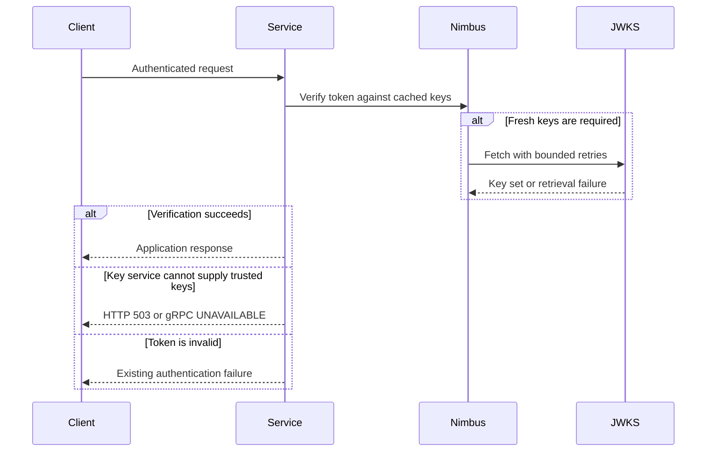

# NV Boot Starter JWT

This is a library that allows operations on JWT:

- Signing
- Verifying signature
- Encrypt JWE
- Decrypt JWE

## Adding as a Dependency

Add to your application's `pom.xml`:

```xml
<dependencyManagement>
    <dependencies>
        <dependency>
            <groupId>com.nvidia.boot</groupId>
            <artifactId>nv-boot-bom</artifactId>
            <version>${nv-boot.version}</version>
            <type>pom</type>
            <scope>import</scope>
        </dependency>
    </dependencies>
</dependencyManagement>

<dependencies>
    <dependency>
        <groupId>com.nvidia.boot</groupId>
        <artifactId>nv-boot-starter-jwt</artifactId>
    </dependency>
</dependencies>
```

## Spring Context Configuration

### Beans the Application Must Provide

The library requires the following beans to be present in the Spring context before it can activate:

| Bean | Type | Description |
|------|------|-------------|
| `privateJwks` | `PrivateJwksString` | Holds the JSON string content of the private JWK Set. Used for signing JWTs and encrypting/decrypting payloads. |
| `jweKeysMapping` | `JweKeysMapping` | Maps keyset names (used in application code) to JWE key IDs (`kid`) in the JWK Set. |
| `encryptedModelConverterProperties` | `EncryptedModelConverterProperties` | *(Optional)* Provide this bean to activate the `EncryptedModelConverter`. Sets the base package to scan for `@ValueObject`-annotated classes. |

Example configuration:

```java
@Configuration
public class JwtConfiguration {

    @Bean
    public PrivateJwksString privateJwks() throws IOException {
        // Load from file, Vault, or other secure source
        ClassPathResource keyResource = new ClassPathResource("keys/jwks_private.json");
        return new PrivateJwksString(
                new String(keyResource.getInputStream().readAllBytes()));
    }

    @Bean
    public JweKeysMapping jweKeysMapping() {
        return JweKeysMapping.builder()
                .keysMapping(Map.of("my-keyset-name", "kid-from-jwks"))
                .build();
    }

    // Optional: provide to enable EncryptedModelConverter
    @Bean
    public EncryptedModelConverterProperties encryptedModelConverterProperties(
            @Value("${my-app.jwt.base-package}") String basePackage) {
        var props = new EncryptedModelConverterProperties();
        props.setBasePackage(basePackage);
        return props;
    }
}
```

### Auto Configuration

The library uses `JwtAutoConfiguration` as the single entry point, which imports `JwksConfiguration`
(in the `configuration` package).

### Beans the Library Auto-Configures

When `PrivateJwksString` and `JweKeysMapping` are present, the library registers these beans:

| Bean | Type                      | Description                                                                                                                                               |
|------|---------------------------|-----------------------------------------------------------------------------------------------------------------------------------------------------------|
| `jwkSet` | `JWKSet`                  | Parsed JWK Set from `PrivateJwksString`.                                                                                                                  |
| `jwtService` | `JwtService`              | JWT signing, verification, encryption, and decryption.                                                                                                    |
| `genericEncryptedJsonMapper` | `JsonMapper`              | JsonMapper configured for encrypted model conversion. Only created if no bean with this name exists.                           |
| `encryptedModelConverter` | `EncryptedModelConverter` | Converts between model and value object types with support for encrypted fields. Only created when an `EncryptedModelConverterProperties` bean is present. |

## Usage

### Generating keys

- [generate EC (private key)](./src/test/java/com/nvidia/boot/jwt/services/JwtServiceTest.java#L201)
- [generate AES (symmetric key)](../src/test/java/com/nvidia/boot/jwt/services/JwtServiceTest.java#L220)

### Getting JwtService

`JwtService` has two dependencies:

- key-set of private keys
- key type to id mapping

The key mapping is needed for your services to be able to rotate encryption keys. Consumer service
will use key type and JwtService will resolve kid using the mapping. This way your app services
don't deal with key ids directly. If you do need to use particular key, you still can.

See [JwtServiceTest](../main/src/test/java/com/nvidia/boot/jwt/services/JwtServiceTest.java)
for more usage examples.

## Remote JWKS retrieval

The resource-free Bazel target `:nv_boot_jwks` provides
`JwksJwtDecoder.create(uri, algorithm)` for remote verification. It does not
activate signing or encryption auto-configuration. NVCF API and SIS use this
client for their trusted static issuers. Other decoder implementations remain
unchanged.

Each key fetch has at most three retriever attempts within a 2.5-second budget,
including response-body reads. Redirect hops and transport retries inside an
attempt can generate additional HTTP requests. Fetch metrics count retriever
attempts and can differ from origin request logs. Connection failures, timeouts and HTTP 429/500/502/503/504
can retry with exponential backoff and jitter. Other HTTP failures, certificate
errors, oversized responses and malformed key sets do not retry. Normal
redirects remain supported within the fetch budget; HTTPS-to-HTTP downgrades
are not followed. A redirect without a Location header is a transport failure
and uses the same bounded retries. Responses are limited to 256 KiB. Failed
fetches share a 500-millisecond cooldown to limit queued refreshes during an
outage.

Nimbus retains its existing five-minute key-cache lifetime and coalesces
concurrent refreshes. Known cached keys remain usable until cache expiration.
An expired cache is not extended during an outage. A successful key refresh
replaces the old key set; an unknown key never authorizes a token.

`JwksAuthenticationManager` maps retrieval failures to a temporary dependency
error. HTTP handlers return 503; the API gRPC handler returns `UNAVAILABLE`.
Invalid signatures, expired tokens and untrusted issuers keep their existing
authentication failures. Issuer, algorithm and application claim validators
must still be configured by each caller.



Production callers pass their existing OpenTelemetry and MeterRegistry beans.
JWKS requests propagate W3C trace context and produce `jwks.fetch` client spans.
The Micrometer counters and timers export as `nvcf_jwks_fetch_requests_total` and
`nvcf_jwks_fetch_duration_seconds`. They use bounded `outcome` values: `success`,
`retryable_error` and `permanent_error`. Counters are registered with zero values
when the decoder is created. Retry logs contain attempt and failure
type, without tokens, key bodies or endpoint query strings.

Run the focused tests from the monorepo root:

```sh
bazel test //src/libraries/java/nv-boot-parent/nv-boot-starter-jwt:jwks_tests \
  --test_output=streamed
```
